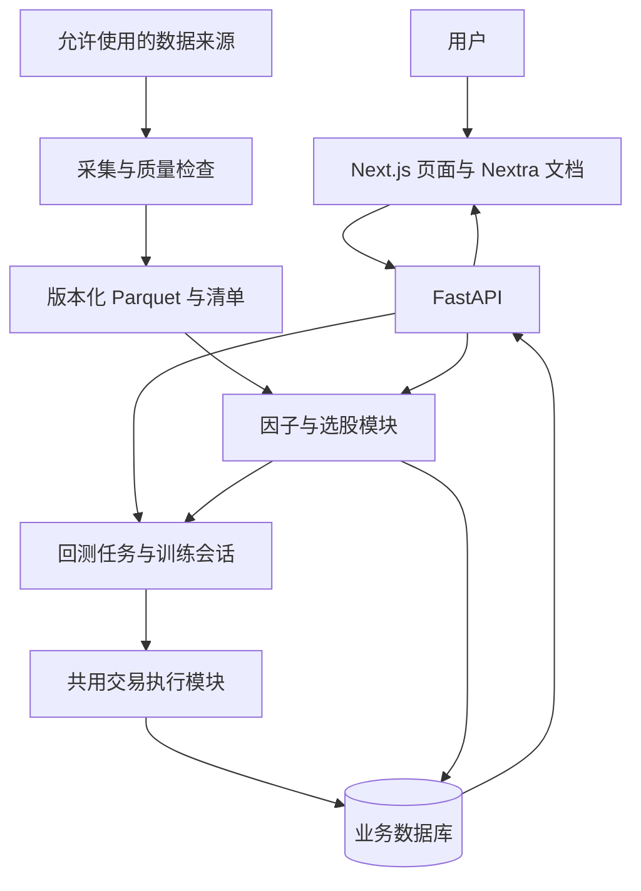

# QuantFlow AI 项目计划书

> 面向 A 股量价策略研究与交易训练的可解释量化学习平台

- 首次编制日期：2026 年 11 月 9 日
- 最近修订日期：2026 年 11 月 11 日
- 项目阶段：前端原型、S11a本地FastAPI基础、S03真实历史小样本、S04a部署能力核验及S04b本地静态导出已完成；公开部署、公开数据条件、业务API、数据库与正式量化计算尚未完成
- 参赛赛事：2026 Qoder 高校创造力大赛（Qoder 主办，天池承载报名与作品发布）
- 建议赛道：StudyHack 学习科研；实际团队所选赛道待成员确认
- 团队规模：3 人，首次开展团队软件项目
- 总预算上限：人民币 500 元
- 文档版本：v2.5（前端本地静态导出验收）；实际验收见docs/implementation-plan.md第7节，Sites公开托管、数据发布/业务读取、交易与持久化仍待推进
- 官方作品发布截止：2026-11-30 18:00；项目按北京时间倒排，页面未单列时区，安排提前提交

## 执行摘要

**项目要交付的是一套从知识理解到实验与练习的学习工具：先用图文学习 K 线、量价关系、ETF 和风险，再在策略实验室理解候选与回测，在 K 线训练场练习操作，最后通过实验记录复盘。正式研究仍以真实历史数据、统一执行规则和可复现结果为目标。**

| 决策项 | 本版实施口径 |
| --- | --- |
| 首要成果 | 一个使用 Qoder 开发、在 Qoder Sites 公开可用的量化学习工具，真实历史数据与复现证据支撑核心流程 |
| 用户与场景 | 初学者先读图文课程，再理解候选与历史实验，练习模拟下单并复盘 |
| 数据范围 | 全 A 股为扩展目标；先在事前确定、数据与规则可验证的样本上交付流程 |
| 首版运行 | 本地开发，Qoder Sites 正式公开交付；历史日线、每位访客独立练习会话、下一交易日开盘成交模型 |
| 核心能力 | 8 个因子、4 组初始风格参数、最多 10 只候选、日频回测、K 线训练、实验留痕 |
| 展示重点 | 真实学习问题、五步以内上手、清晰体验及真实 Qoder 制作过程；计算严谨性是产品质量依据 |
| 非首版依赖 | 实时行情、AI 聊天、自动风格学习、注册账户及排行榜不阻塞核心验收；公开访问及访客隔离为 P0 |
| 资源边界 | 3 人、500 元；先核实实际工时，再锁定可交付范围 |
| 下一步 | 确认全员资格 → S04c Sites实际预览与公开部署、独立后端路线验证 → 明确公开数据条件并跑通线上五步流程 → 扩大覆盖 |

**最低交付判断：** 评委打开公开的 Qoder Sites 地址，无需安装环境或导入数据，五步以内完成一次候选解释、历史实验与模拟操作；作品帖满足官方字段，并如实展示 Qoder 开发与部署过程。固定数据与计算可以复现；数据不足或事件未处理的实验不能作为完整收益结论。本地文件和录像不能替代公开作品。

### 官方评分对齐

官方列出四个关注点，未公布权重，并明确“技术复杂度不计分”。以下为项目对齐措施，不是自拟官方评分公式。

| 官方关注点 | 本项目应提供的证据 | 本版取舍 |
| --- | --- | --- |
| 问题真实 | 学生学习量价与回测时的具体困难、真实试用记录 | 建议邀请 3–5 名同学试用，不虚构人数或改善效果 |
| 核心流程可用 | 一个预置真实案例，评委五步内能操作 | 默认参数直接可用，高级参数折叠 |
| 体验与设计 | 候选解释、成交原因、加载与错误状态清晰 | 优先消除使用障碍，再增加图表数量 |
| Qoder 使用深度 | 任务、生成内容、人工修改、验证及 Sites 部署截图 | 实际在 Qoder 完成参赛开发与部署，不伪造工具使用记录 |

官方来源：[赛事介绍](https://tianchi.aliyun.com/competition/entrance/532536)、[赛题与数据](https://tianchi.aliyun.com/competition/entrance/532536/information)。详细事实、摘录范围及未知项见 [赛事核对记录](docs/competition-requirements.md)。

### 阅读顺序

| 阅读对象 | 建议先看 | 用途 |
| --- | --- | --- |
| 全体成员 | 本摘要、第 7–10 节、第 30–35 节 | 统一范围、分工与验收 |
| 研究与数据开发 | 第 11–19 节 | 确定输入、公式、成交和评价口径 |
| 网页与接口开发 | 第 20–29 节 | 复用模板、页面布局及联调契约 |
| 答辩与提交 | 第 35–39 节 | 整理证据、演示和最终检查 |

本计划区分已确认条件、建议默认值与待核实事项。正文四部分均已编制，业务功能仍未开发；文档完成不等于项目完成。

## 第一部分：项目定位与产品范围

### 1. 项目背景

大学生学习量化交易时，常见困难包括：不了解量价指标如何组合使用、无法解释选股理由、缺少验证策略的工具，以及难以将模拟交易与复盘形成连续流程。

QuantFlow AI 将历史数据、因子计算、策略筛选、历史回测和 K 线训练整合在一个平台中，帮助学生建立有数据依据、可解释、可复现的研究方法。平台输出的是符合策略条件的候选股票，不承诺股票上涨或未来收益。

### 2. 已确认的项目条件

| 项目条件 | 已确认内容 | 对实施的影响 |
| --- | --- | --- |
| 比赛 | 2026 Qoder 高校创造力大赛，建议 StudyHack | 官方规则已读取；成员资格、认证及团队选择仍需本人核对 |
| 当前进度 | 前端原型、后端基础、本地数据小样本、Sites能力与前端静态导出已核验 | 验证实际Sites部署、独立后端和公开数据条件，再接入业务读取及执行 |
| 团队 | 三人，暂无合作项目经验，工作尚未分配 | 任务必须拆小，提供明确输入、输出与验收条件 |
| 预算 | 总计 500 元 | 优先保障数据使用及评审期公开访问，核实可领取学生权益 |
| 数据条件 | BaoStock匿名本地采样已通过，无业务数据库 | 公开展示/再分发未确认；补齐交易限制与权益事件 |
| 研究范围 | 主要研究全部 A 股 | 分阶段扩大覆盖范围，不把小样本结果包装成全市场结论 |
| 行情保底 | 历史回放可作为正式交付 | 可使用历史数据，但作品仍须由 Qoder 部署至 Sites 公开访问 |
| 模拟交易 | 平台自带练习账户、类似 K 线模拟器 | 无需对接赛事账户或实盘交易系统 |
| 核心展示重点 | 因子与回测严谨，结果能够复现 | 作为质量基础，并按官方要求补齐易用性与 Qoder 过程证据 |

### 3. 产品定位与核心价值

**产品名称：QuantFlow AI。**

**比赛版定位：面向 A 股量价策略研究与交易训练的可解释量化学习平台。**

目标用户包括大学生金融与创新竞赛参与者、量化投资初学者，以及希望学习量价分析和策略验证的学生。

核心价值：

1. **可解释：** 展示候选股票的原始因子、标准化分数、权重和评分贡献。
2. **可验证：** 使用明确的成交、费用和持仓规则进行历史模拟。
3. **可复现：** 保存数据版本、参数、代码版本与实验记录，使相同输入产生一致结果。
4. **可练习：** 隐藏未来行情，通过逐日推进的 K 线训练检验交易决策。

“AI”保留为产品品牌及后续解释能力的方向。第一版的核心研究能力由明确的数据与算法规则实现，是否接入大语言模型不影响主要流程验收。

本次是创造力与应用交付赛事，不是以金融收益排名的交易比赛。StudyHack 的参赛叙事是“帮助学生理解和验证量价策略”，不把战胜市场或复杂模型作为参赛必要条件。官方没有要求作品必须内置 LLM；使用 Qoder 完成开发与部署则是明确要求。

### 4. 产品原则

- 候选排名反映策略条件匹配程度，不代表上涨概率。
- 只使用信号时点已经可获得的数据计算指标与排名。
- 行情必须标明来源、数据日期、获取时间和运行模式。
- 历史回放、最新日线和盘中实时行情分别标识，不混用概念。
- 允许策略未跑赢基准；报告真实结果、适用范围及局限。
- 不把模板登录演示视为真实鉴权，不把示例数据作为真实绩效。
- 用户策略调整应透明可见；后续行为学习产生的调整建议须由用户确认。

### 5. 两条核心流程

#### 5.1 策略研究流程

选择数据版本与历史区间 → 确定股票池 → 设置风格及参数 → 计算因子与评分 → 生成最多 10 支候选股票 → 按后续可成交时点回测 → 查看绩效、成交与拒单记录 → 保存实验。

候选股票不足 10 支时，输出实际合格数量并解释原因，不通过放宽条件或补入不合格股票凑数。

#### 5.2 K 线训练流程

选择训练区间 → 建立虚拟资金账户 → 显示截至当前回放日的行情 → 提交模拟委托 → 推进至下一交易日 → 按规则处理成交 → 查看持仓与资产 → 完成训练并复盘。

历史训练时，图表、指标、选股结果及接口响应都不能泄漏回放日期之后的数据。训练场与回测共用成交和费用规则，避免计算口径分裂。

#### 5.3 面向评委的五步首次体验

1. 打开 Qoder Sites 公开地址，通过首页逐屏介绍进入知识学习室，阅读一节量价图解。
2. 进入策略实验室，搜索证券并查看一只候选股票的因子贡献与入选理由；正式交付默认装载允许公开展示的真实数据版本。
3. 打开同参数历史实验，核查回撤、基准及一笔成交；预先计算的结果明确标识为已保存实验。
4. 进入训练，提交一笔虚拟委托并推进到下一交易日。
5. 查看成交或拒单原因、资金变化及对应规则，必要时重置练习。

无需注册金融账户、下载文件或阅读长说明书。真实数据与规则解释保留在详情中，高级参数不阻断默认路径。邀请试用者独立操作并记录卡点，不能以团队成员熟练演示代替新用户可用性验证。

以上是正式交付目标。当前图文课程可阅读，股票搜索仅查询本地预置样例；评分、回测和记录展示不代表真实计算，训练仍为合成行情与内存账户。ETF 知识教学不扩展当前训练的交易品种。

### 6. 比赛版页面规划

| 页面 | 核心内容 | 用户主要操作 |
| --- | --- | --- |
| 知识学习室 | K线、量价、ETF、风险的图文课程与案例 | 选择主题、阅读图解，再进入实验或练习 |
| 策略实验室 | 股票搜索、候选解释与评分、回测区间、费用、净值及交易明细 | 查找证券、理解候选，再查看或运行历史实验；多实验对比放入 P1 |
| K 线训练场 | 历史 K 线、虚拟资金、委托、持仓和逐日推进 | 模拟买卖，推进交易日，查看拒单原因 |
| 实验记录 | 选股快照、回测结果、训练记录及参数版本 | 重新打开实验，复现结果；自动报告导出放入 P1 |

四个页面是导航结构，不代表四套独立系统。整体采用蓝白配色，每页围绕一个主要任务；参数、因子和交易明细通过折叠或标签页按需查看。按用户2026-11-11的新要求，首页背景铺满，去掉外层矩形卡片，滚轮一次手势切换整屏介绍；短屏先读完本屏内容；基础教学提升至知识学习室，原工作台的候选筛选与评分解释并入策略实验室。导航仅保留四个模块及旁边的圆形问号帮助入口，顶部搜索框移除，股票搜索位于实验室，文档搜索位于帮助首页。实验对比和自动报告导出仍放入 P1。

### 7. 功能优先级

#### 7.1 P0：必须完成

- 使用 Qoder 开发并部署到 Qoder Sites，公开可访问，保留真实制作与部署证据。
- 预置默认案例和五步体验；访客练习互不覆盖，提交材料满足官方字段。
- 知识学习室提供准确的图文入门内容；知识图例标明教学性质，不把量价形态当作必然预测，不把ETF课程等同于ETF交易支持。
- 一个可验证历史样本的日线导入、基本清洗、质量报告及来源记录。
- 8 个基础量价因子及明确的计算口径。
- 趋势、短线动量、波段、稳健四种可查看和修改的初始参数。
- 股票池过滤、评分排序、最多 10 支候选股票与评分构成。
- 日频回测、成交成本、资金与持仓约束、T+1 规则。
- 累计收益、最大回撤、双边换手率及明确口径的基准比较；其他指标按第 17 节分级实现。
- 单练习账户的 K 线回放、模拟买卖、持仓与资产记录。
- 保存信号、参数、数据版本、成交及实验结果。
- 页面清晰显示历史回放或最新日线状态。

#### 7.2 P1：核心验收通过后再做

- 自动获取当日收盘后的最新日线。
- 在数据使用条件与稳定性明确后接入分钟行情。
- AI 基于真实因子、回测和交易记录生成解释。
- 根据足够的完整模拟交易提出风格调整建议。
- 更丰富的实验对比、研究报告导出和账户管理。

#### 7.3 P2：比赛后考虑

- 分钟级回测、复杂多因子优化与自动参数搜索。
- LSTM、Transformer、强化学习和多 Agent。
- 多用户排行榜、复杂权限与大规模服务架构。
- 实盘接口及自动交易。

#### 7.4 首版范围锁定与降级顺序

M0 结束时冻结一份实施清单：数据来源与版本、样本定义、日期区间、支持板块、执行规则、实际部署方式，以及每人可用工时。任何新增功能都要说明替换哪项工作，不只在列表上继续追加。

范围不足时按以下顺序调整：先移除 P1，再减少页面装饰和研究规模；最后交付清晰标注范围的教学实验。因子正确性、未来数据隔离、现金持仓一致性和真实来源说明不得降低要求。

验收分开记录三件事：**赛事准入及提交是否合格**、**功能是否正确易用**、**当前数据是否足以支持研究结论**。教学流程可以通过，受限数据下的全市场收益结论仍应标记“尚不支持”；没有合格公开地址不能视为参赛交付完成。

### 8. 全 A 股目标的实施边界

全 A 股是数据覆盖与研究目标，不等于第一天就具备完整的全市场历史回测能力。实施顺序为：

1. **字段核对：** 先用约 5 只股票检查下载、价格口径及单位，不用它们证明策略有效。
2. **流程验收：** 建议选取 30–100 只主板证券、约一年日线及预热区间，先完成真实数据闭环；具体数量由 M0 数据验证决定。
3. **扩大研究：** 在质量、工时和调用限制允许时，扩大覆盖至全 A 股。其他板块的执行能力按规则模块分别启用。
4. **公开范围：** 样本名单或入池方法在查看策略绩效前冻结，保存其选择依据。历史股票池按当时可获得的信息构建，缺少退市股或历史状态时披露偏差。

不能只使用今天仍上市的股票宣称完成无幸存者偏差的历史回测，也不能用未来数据完整性决定历史日期的入池资格。

首版执行模块优先支持规则与历史状态可验证的沪深主板普通股票，暂不支持的板块可展示研究数据但不能产生模拟成交。不因某只股票在测试期表现差、发生停牌或公司行动就事后从样本删除。

### 9. 第一版成功标准

比赛版应能现场展示一次完整实验：选择策略与历史日期，核查候选股票的评分，运行回测，检查下一交易时点的成交记录，再进入使用相同交易规则的 K 线训练。

核心成果不是保证盈利，而是使评委能够回答以下问题：数据来自哪里、股票为何入选、交易为何成交或拒绝、收益如何计算，以及相同实验能否重现。

### 10. 已确认赛事规则与仍待办理事项

官方已确认：1–3 人在校学生团队；报名组队和作品帖子发布均于 2026-11-30 18:00 截止；使用 Qoder 开发和部署至 Sites；论坛标题注明赛道，正文五部分齐全并写明 Qoder 账号。所有成员必须在初赛截止前完成天池实名认证与阿里云大学生认证。

仍需办理或验证：

- 各成员资格、认证、实际组队状态、StudyHack 选择及可投入工时。
- Qoder CN 学生权益是否可领、是否已领以及期限；不假定领取或到账。
- Sites 支持的框架、后端调用、存储与配额，尚不能据赛事页认定支持 Python/FastAPI 或 Next.js 服务端。
- 数据的真实覆盖、质量和公开展示/缓存权限。
- 官方后续通知、具体决赛时间以及提交页面最新字段。

不把赛事结束日期 12 月 15 日当作投稿截止。本计划按北京时间提前完成投稿，网页正文未单列时区；提交前再核查最新公告。

---

## 第二部分：数据、量化与交易规则

本部分规定首版建议实现的计算口径。数据服务的实际可用性、授权条件和覆盖范围仍需开发阶段验证；以下参数是实验起点，不代表已经验证有效。

### 11. 数据获取与运行模式

#### 11.1 三种行情模式

| 模式 | 数据要求 | 页面标识 | 优先级 |
| --- | --- | --- | --- |
| 历史回放 | 固定版本的历史日线和交易日历 | 历史回放、当前回放日期、数据版本 | P0，正式交付保底 |
| 最新日线 | 可稳定获取最近完成交易日的行情 | 日线数据截至某日、最近获取时间 | P1 |
| 分钟行情 | 具备明确使用条件且稳定的分钟接口 | 行情时间、获取时间、延迟或过期状态 | P1，条件满足后接入 |

历史回放模式不受当前系统日期驱动，所有业务计算使用回放时钟。分钟模式如后续实现，目标采集间隔为 60 秒；前端刷新频率单独记录，不等同于数据源更新频率。接口失败时保留最后成功的数据并显示过期状态，不修改时间戳冒充新行情。

#### 11.2 数据源调研顺序

1. 优先测试有文档的公开接口或开源工具，例如 BaoStock、AKShare 可访问的数据能力；Tushare 等作为权限和预算允许时的候选。
2. 对每个来源检查使用条款、调用限制、数据覆盖和字段口径。开源工具的代码许可不自动授予第三方行情的展示或再分发权。
3. 如使用网页采集，限于允许访问和采集的内容，遵守站点限制，不绕过登录、验证码或访问控制。
4. 在允许范围内缓存原始数据，采用限速、有限重试、断点续传和增量更新，避免反复全量下载。
5. 若来源不能满足公开展示条件，寻找允许使用的替代数据；不能仅因采用历史回放就默认可以公开再分发。

以上均为候选路线，尚未确认任何来源可免费提供完整、稳定且允许比赛展示的全 A 股数据。数据源选型结果应保存为独立调研记录。

#### 11.3 数据清单与功能开放条件

数据验证分两道门槛：**基础数据通过**后，可进行行情展示、因子核对和明确标注的教学回放；**收益实验通过**还要求所选证券与区间的成交状态、价格限制、公司行动及持仓估值可处理，才可输出完整绩效结论。历史行业数据不作为 P0 前置条件，缺失时关闭行业约束并披露。

| 数据 | 必需字段或信息 | 用途 |
| --- | --- | --- |
| 证券基本信息 | 带市场标识的代码、名称、板块、上市及退市日期 | 股票识别与历史入池 |
| 交易日历 | 日期、交易所、是否交易日 | 日推进、调仓、T+1 |
| 日线 | 日期、未复权 OHLC、成交量、成交额、来源 | 成交模拟与量价研究 |
| 历史证券状态 | 停牌、ST、退市整理及生效日期 | 当时可交易性判断 |
| 价格限制 | 当日适用涨跌停价或可核验的规则数据 | 拒单与成交约束 |
| 公司行动 | 分红、送转、拆并股及适用日期 | 价格连续性和账户记账 |
| 基准行情 | 指数日期、收盘值、指数口径 | 绩效比较 |
| 行业分类 | 行业及生效时间；若无历史版本须标注 | 行业集中度约束 |

行业历史数据缺失时，不能把当前行业分类描述为当时分类。可暂时关闭历史行业约束并披露，或将当前分类实验明确标记为探索性结果。

历史日线争取覆盖三年以上，至少争取一年用于有限实验；这不是数据已取得的承诺。回测起点之前另准备不少于 80 个交易日的预热数据，确保 MA60 等指标有足够输入。

### 12. 数据清洗、版本与质量

#### 12.1 统一字段口径

- 证券代码使用字符串并包含市场标识，保留前导零。
- 成交量统一为股，成交额与价格统一为人民币元；转换规则写入来源适配器。
- 业务时间采用 Asia/Shanghai；区分事件生效日期、信息可获得时间和实际采集时间。来源没有历史发布时间时记录为未知，不以采集时间冒充历史可得时间。
- `(证券代码, 交易日期, 数据版本)` 唯一；重复、冲突和修订记录保留处理日志。
- 空值不替换为零，不使用未来值回填；真实零成交量也不能自动当作停牌证明。
- 账户金额使用定点精度，按规则在费用和成交环节取整；研究计算可使用浮点数。

#### 12.2 质量检查

检查 OHLC 为有效正数、高价不低于开收盘及低价、低价不高于开收盘、成交量与成交额非负、日期有序且无重复。结合交易日历和状态区分正常停牌、尚未上市和采集缺失。异常大幅变动应核对公司行动和来源，不能仅因涨跌幅较大就直接删除。

至少人工抽查 5 只股票、各 5 个日期，对照来源核对价格、量额单位和指标输入；此抽查只验证适配口径，不足以证明整个数据集无误。

每次导入输出质量报告：应覆盖与实际覆盖范围、成功和失败数量、缺失率、重复数、异常数、处理动作及未解决问题。数据不足的股票当日不参与评分，记录具体排除原因。

#### 12.3 数据版本与复现记录

建议原始下载文件只追加保存，清洗结果按版本生成。每份数据集保存清单：来源、请求参数、采集时间、日期范围、证券范围、文件校验值、清洗代码版本、字段口径与已知限制。

每次实验至少绑定 `dataset_version`、`strategy_version`、`execution_rule_version`、代码提交标识、参数、运行区间和随机种子（如涉及随机抽样）。后续修订数据不得静默覆盖已完成实验的输入。

公开历史接口可能只返回修订后的数据。使用这类来源时，注明“基于本次下载版本重建历史”，不能宣称完整还原当时发布的数据。截断一致性检查能排查代码读取未来信息，但不能证明上游历史数据从未修订。

### 13. 股票池与价格口径

#### 13.1 当日股票池过滤

在信号日 t 收盘后，按当时可获得的信息依次检查：

1. 当时已上市、未退市，且满足建议的 120 个交易日上市时间门槛。
2. 当日不是停牌、ST 或退市整理等被策略排除的状态。
3. 最近窗口内数据足够且质量检查通过。
4. 过去 20 个交易日平均成交额达到初始门槛 2,000 万元；门槛可配置并记录。
5. 策略所需因子全部有效；不补造缺失因子。

保留每一步的数量变化和排除原因。下一交易日是否可成交仍由执行引擎重新检查，不根据 t+1 的停牌或涨跌停提前改变 t 日排名。

全 A 股中的板块规则并不一致。数据层可逐步覆盖所有板块，执行层仅启用已经实现并验证对应交易规则的证券；暂不支持的板块应明确标识，不能统一套用主板规则。

#### 13.2 研究价格与成交价格

- 研究因子使用在信号日期可构建的连续价格序列，保存调整方法及版本；OHLC 的调整尺度一致。
- 不能无条件使用按今天信息生成的整段前复权数据模拟过去可获得的数据。
- 模拟成交使用未复权真实价格，账户单独处理现金分红、送转等公司行动。
- 权益按对应登记日持仓与适用规则确定，除息时确认应收股息，到账时再转为可用现金；送转股的权益确认、上市可卖日期分开处理。
- 净资产包含现金、持仓市值和应收权益；记录税费假设，避免复权收益和账户分红重复计入。

若不能处理必要的公司行动，在该事件处停止收益实验并标记“不完整”，不继续生成完整区间收益。教学展示可保留，但不能事后筛掉发生分红、停牌或退市的股票再把结果作为无偏验证。

### 14. 八个基础因子定义

设 C、H、L 为同口径研究收盘价、最高价和最低价；V 为成交量，A 为成交额。MA_n 为截至当前日、包含当前日的 n 日简单平均。所有窗口按交易所日历对齐，n 日指最近连续 n 个交易日，不先删除缺失或停牌记录再拼接窗口。必要输入无效则该因子无效；每个指标仅使用截至信号日 t 已完成的日线。

| 类别 | 因子 | 首版公式 | 方向与解释 |
| --- | --- | --- | --- |
| 趋势 | 均线相对位置 | MA20(C)_t / MA60(C)_t − 1 | 较高表示中短期趋势相对较强 |
| 趋势 | 均线变化率 | MA20(C)_t / MA20(C)_(t−5) − 1 | 较高表示近期均线抬升 |
| 动量 | 5 日收益率 | C_t / C_(t−5) − 1 | 较高表示近期动量较强，不等同于未来上涨 |
| 动量 | 20 日收益率 | C_t / C_(t−20) − 1 | 较高表示中期动量较强 |
| 量价 | 成交量比值 | V_t / mean(V_(t−20), …, V_(t−1)) | 相对前 20 日放量程度 |
| 量价 | 价量变化相关性 | corr(r_d, g_d)，d=t−19,…,t | r_d=C_d/C_(d−1)−1；g_d=V_d/V_(d−1)−1 |
| 流动性 | 平均成交额 | mean(A_(t−19), …, A_t) | 较高表示流动性相对较好 |
| 风险 | ATR14 比例 | ATR14_t / C_t | 较高表示波动风险较高，评分时反向 |

ATR 的真实波幅定义为 `TR_t=max(H_t−L_t, abs(H_t−C_(t−1)), abs(L_t−C_(t−1)))`。ATR14 首个值取连续 14 个有效 TR 的简单平均，后续采用 Wilder 平滑：`ATR14_t=(13×ATR14_(t−1)+TR_t)/14`。首个 TR 也需要前一日收盘价。每只证券的初始化起点由数据版本固定，图表查询区间变化不重新初始化；发生输入缺失时标记无效，并在重新积累连续 14 个有效 TR 后重启计算，重启日期写入因子元数据。

价量变化相关性使用 20 组有效配对和 Pearson 相关系数；分母为零、窗口不足或某一序列零方差时标记无效。成交量比值的分母不包含当日；历史均量为零时无效。公司行动影响成交量可比性时，需采用有依据的统一调整方法，或将受影响窗口标记无效。

成交量比值本身没有看涨方向。评分时使用派生特征 `sign(r_t)×log(1+成交量比值)`，区分放量上涨与放量下跌；原始比值仍单独展示。该映射是待检验的策略假设。

### 15. 标准化、风格与候选排序

#### 15.1 截面标准化

同一天对合格股票进行截面计算，不能用整个未来回测区间估计分布。首版流程：

1. 平均成交额先取 `log(1+A)`，成交量比值采用上一节的方向映射。
2. 对每个特征按当日截面 2.5% 和 97.5% 分位数缩尾，分位数采用固定的线性插值实现。
3. 计算 `z=(x−median(x))/(1.4826×MAD)`，MAD 为绝对偏差的中位数。
4. MAD 为零时使用总体标准差；标准差也为零时该特征统一取 z=0。
5. 将 z 截断至 [−3,3]，映射为 `s=50+(50/3)×z`；风险因子使用 `100−s`。

合格截面少于 20 只时暂停正式排名并展示样本不足；小样本仅用于单元验证。分数为相对策略分数，不是概率。缺失值不参与排名，也不临时重分配权重来掩盖缺失。

#### 15.2 风格权重

类别内等权平均，再按类别权重求和。趋势与动量各含两个特征，量价含两个特征，流动性与风险各含一个特征。

| 类别 | 趋势型 | 短线动量型 | 波段型 | 稳健型 |
| --- | --- | --- | --- | --- |
| 趋势 | 35% | 15% | 25% | 15% |
| 动量 | 20% | 35% | 15% | 10% |
| 量价 | 20% | 30% | 20% | 10% |
| 流动性 | 10% | 10% | 10% | 20% |
| 风险控制 | 15% | 10% | 30% | 45% |

综合分为 `Score_i=Σ(类别权重×类别得分)`。风险已通过反向分数计入，首版不再叠加相同 ATR 的额外风险惩罚。权重必须非负且归一化，任何修改生成新策略版本。以上权重为原型参数，未经回测不能称为最优。

按综合分降序选择最多 10 只；同分按证券代码固定排序。有可靠历史行业信息时，每个行业最多 3 只，按排名依次纳入；不足 10 只就保留现金，不降低门槛凑数。

每个信号快照保存：信号时间、证券、数据版本、原始因子、转换值、标准化参数、类别贡献、总分、排名、过滤规则与策略版本。

#### 15.3 行为学习的后续范围

第一版不自动学习权重。P1 至少积累 30 笔完整平仓交易后，才考虑依据持有期、波动偏好和集中度生成建议；该门槛仅为产品保护条件，不代表统计充分。

建议权重可采用 `W_new=(1−α)W_explicit+αW_behavior`，初期 α 上限建议为 0.1；用户确认后生成新版本，支持关闭和撤回。不能仅因某类交易盈利就直接提高对应权重。

### 16. 回测与训练共用执行规则

#### 16.1 首版默认配置

下列参数冻结为一个执行规则版本；费率与证券交易规则须在 M0/M2 中核对。首版支持范围以第 8 节为准，不要求同时实现所有板块的下单规则。

| 参数 | 建议初值 | 说明 |
| --- | --- | --- |
| 初始资金 | 100,000 元 | 纯虚拟资金，不允许融资和做空 |
| 最大持仓数 | 10 只 | 排名不足或无法成交时保留现金 |
| 调仓频率 | 每周最后一个交易日收盘生成信号 | 下一交易日开盘尝试成交；节假日依交易日历判断 |
| 目标仓位 | 每只目标为信号日净资产的 10% | 不足 10 只时不提高其他股票的目标比例 |
| 佣金 | 成交额的 0.03%，每笔最低 5 元 | 教学默认假设，可配置，不声称为所有券商费率 |
| 滑点 | 买入 +5bp，卖出 −5bp | 相对下一日开盘价，属于模拟假设 |
| 税费 | 按交易日期适用的版本表 | 印花税、过户等项目独立记录；实施时核对来源 |
| 订单有效期 | 仅下一交易日开盘一次尝试 | 未成交部分撤销，不无限顺延 |

调仓按以下固定顺序生成和处理委托：

1. 信号日用净资产计算目标金额，用未复权收盘价换算目标股数并按规则取整；未入选股票的目标股数为零。
2. 本次委托数量为目标股数与已有持仓的差额，不对已有股票重复买入完整目标金额；零差额不下单。
3. 先按证券代码顺序处理卖单，再按候选排名处理买单。卖出失败的旧持仓继续占用名额，新增买入不得使实际持仓超过 10 只。
4. 自动调仓买单可根据执行价、费用和剩余现金向下取整缩量，记录原数量、实际数量和原因；小于最小申报数量则拒单。手动训练订单默认全量成交或拒单，不静默改量。
5. 价格跳空、手数和未卖出持仓会使实际权重偏离目标 10%，报告该偏离，不把目标仓位称为严格上限。

执行检查只能使用执行时点已知的信息，不使用当天收盘价、全天成交量或最高最低价决定开盘成交。费用按每笔实际成交计算；这是日线成交模型，不能保证真实开盘的成交量和价格。

#### 16.2 事件顺序

1. 信号日 t 收盘后计算指标、排序和目标委托，保存快照。
2. t+1 按规则处理权益确认、实际到账、股份解锁和交易状态；尚未到账的应收权益不可用于买入。
3. 使用 t+1 未复权开盘价及滑点处理卖单，再处理买单；顺序采用第 16.1 节约定，训练手动单按创建序号排序。
4. 检查现金、持仓、可卖数量、申报数量、价格限制和费用；可成交则记账，否则记录拒单原因。
5. t+1 收盘按可获得价格估值，保存现金、持仓市值、应收权益、费用和净资产。

净资产必须等于现金加持仓市值加应收权益。每日状态都应能从初始资金和事件日志重建；缺少必要事件时实验标记不完整，不靠修改净值使账目平衡。

#### 16.3 T+1、申报数量与价格约束

- 按买入批次记录股数和买入日期；当日新增股票不能当日卖出。
- 主板等适用证券的买入按 100 股整数倍处理；其他板块的最低申报和增量规则采用独立规则表。
- 卖出零股及清仓条件遵循对应证券规则，不能统一按买入手数逻辑处理。
- 缺少可靠的当日交易状态、价格限制或板块规则时，不进行正式成交模拟，明确拒单或暂停该实验。
- 为避免日线数据无法重建排队，开盘处于涨停时拒绝买入，开盘处于跌停时拒绝卖出；这是公开的保守成交假设。
- 滑点价格按最小报价单位处理；超出当日允许价格范围时拒绝成交。
- 停牌不成交。持仓停牌时沿用最后有效估值并标记陈旧；异常缺价不能静默填充，必要时暂停实验。
- 退市或长期无法定价不能删除持仓或凭空按零价卖出，必须采用有来源的结算规则；无法处理时结果标记不完整。

日线回测无法还原订单队列、盘中路径和真实市场冲击。首版不实现限价单、盘中止盈止损及复杂订单类型；所有绩效报告保留该限制说明。

#### 16.4 K 线训练的操作规则

用户在 t 收盘状态下提交下一交易日委托，可在推进前撤销；点击“下一交易日”后执行同一事件流程。训练中的日期选择、图表、因子、候选与账户估值使用同一回放时间。最后一个可成交日之后不再接受无法执行的委托；期末未平仓股票按可获得的收盘价计入净资产，不虚构一次强制平仓。

逐日训练不会提供盘中卖出入口，T+1 仍由执行模块强制验证，不能只依赖前端按钮限制。

后端只返回截至回放日的行情与指标，不能把整段未来行情发送到浏览器后仅在图表上隐藏。训练起点可固定或随机，随机种子需保存；股票池不能按事后涨幅挑选。

### 17. 回测评价与基准

设 E_0 为初始净资产，E_T 为期末净资产，r_t 为每日净资产收益率，N 为实际记录的日收益观察数。无外部入金和出金。

P0 必须交付累计收益、最大回撤、双边换手率及基准比较；年化和夏普在日净值正确后计算。胜率与盈亏比依赖已核对的平仓配对，列为 P1 展示项，不阻塞核心闭环。以下公式是实现时的统一口径，不代表所有图表都要首周完成。

| 指标 | 首版口径 |
| --- | --- |
| 累计收益率 | E_T/E_0−1，已扣模拟费用 |
| 年化收益率 | (E_T/E_0)^(252/N)−1；短区间明确标注不稳定 |
| 最大回撤 | max_t(1−E_t/max_(s≤t)E_s)，报告非负跌幅幅度 |
| 夏普比率 | sqrt(252)×mean(r_t−r_f,d)/std(r_t−r_f,d)，样本标准差；首版默认无风险收益为 0 并披露 |
| 换手率 | 每日买卖成交额之和 / 前一日净资产；另报告区间累计值，不与单边定义混用 |
| 胜率（P1） | FIFO 已平仓配对片段中，扣分摊费用后盈利片段数 / 全部已平仓片段数；明确计数单位 |
| 盈亏比（P1） | 已平仓配对片段的平均盈利金额 / 平均亏损绝对额 |
| 超额收益 | 策略累计收益率减同区间基准累计收益率，以百分点报告 |

未平仓头寸参与资产收益，不计入胜率和盈亏比。采用 FIFO 保存部分平仓配对并分摊费用；报告盈利、亏损、持平片段数量，不将片段数混称为完整交易轮次。

无交易且资金不变时，累计收益、最大回撤、换手率为 0，胜率和盈亏比不可计算；收益零波动时夏普不可计算；无亏损时盈亏比不可计算，不报告无穷大。年化仅在 N>0 且期初、期末净资产为正时计算，短样本标注不稳定；夏普至少需要两条有效日收益。空值和合理的零值必须区分。

基准分为两种，均与策略对齐起止时点：

- **市场参考：** 沪深 300 指数，说明是价格还是全收益口径。指数曲线未扣练习账户费用，不能称为同条件可执行组合。
- **执行对照：** 在同一当日合格股票池中，用事先固定的随机种子选择最多 10 只等权目标股票，采用相同调仓、资金、硬性约束、手数、费用和成交引擎。抽样前固定证券排序、随机算法与版本，种子在查看结果前冻结；报告随机性，多个种子的稳健性比较为 P1。

10 万元资金不直接建立全 A 股等权实盘式组合，以免每只预算低于最小手数。理论全市场等权指数可作为后续研究，但须说明碎股和费用假设。缺失的基准不画虚构曲线；若连一个可执行对照都无法完成，研究验证项保持未通过。

### 18. 研究验证与防错验收

#### 18.1 数据与时间验证

- **截断一致性：** 将数据截断到 t 日重新计算，t 日因子与信号应和完整运行一致。
- **下一时点成交：** t 日收盘生成的信号不能在 t 日收盘成交。
- **历史股票池：** 入池条件不读取未来上市状态、退市结果或未来数据完整性。
- **回放隔离：** 检查训练接口响应和图表数据不存在回放日之后的数据。

#### 18.2 计算与执行验证

- 使用可手算的小样例核对均线、收益率、ATR、标准化和评分贡献。
- 检查常数序列、零成交量、缺失窗口、无候选及不足 10 只的结果。
- 验证资金不足、T+1、停牌、涨跌停、零股、公司行动及重复提交；增加“已有持仓不重复买满”和“卖出失败不突破持仓数量上限”案例。
- 验证成交、费用和每日资产恒等式；同一输入的回测与训练执行结果一致。
- 相同环境、数据版本、参数与代码重复运行，候选代码、排序和整数股数完全一致，货币按分记账后完全一致；浮点因子比较采用 `abs(a−b)≤1e−8+1e−6×abs(b)`，实际阈值与库版本一并记录。

#### 18.3 样本外研究

首版为规则策略，不必训练机器学习模型。默认先用较早区间做开发与参数校验，冻结后仅运行较晚的留出区间；如进行多组调参，再分为开发、验证和样本外测试区间，例如 60%/20%/20%，并记录尝试次数。不能随机打乱时间。预热只读取此前历史，不能用测试结果重新优化后仍称其为未见测试。

在固定基线正确运行后，再增加滚动前推实验。每轮仅用当时的训练与验证窗口确定参数，在下一测试窗口冻结参数；输出各窗口结果及聚合口径。数据不足时优先保留固定样本外验证，不勉强宣称完成充分的 Walk-forward 研究。

至少比较原型策略与简单基线，并检验提高交易成本、轻微调整参数后的结果是否稳定。报告失败实验及数据限制，不以筛选最佳历史曲线作为有效性证明。

### 19. 本部分对应交付物

1. 数据源验证表及实际使用条件记录。
2. 带版本清单的原始与清洗数据、质量报告。
3. 因子定义、标准化及评分实现与核对样例。
4. 股票池过滤日志与不可变信号快照。
5. 回测和训练共用的交易规则、费用版本与事件日志。
6. 包含净值、成交、基准、样本外结果和局限说明的研究报告。

---

## 第三部分：网页设计与技术架构

本部分为待实施的工程方案，尚未创建业务页面、数据库或 API。仓库模板及其 skill 已下载，模板依赖安装、构建和部署兼容性将在开发阶段验证。

### 20. 网页参考来源与采用范围

#### 20.1 已取得的参考资料

- 上游仓库：https://github.com/pdsuwwz/nextjs-nextra-starter
- 参考提交：`05b8bd442637ef59c888aa0283283af27d8b3b90`。
- 本机参考克隆：`references/nextjs-nextra-starter/`；截至 2026-11-10 核对时，该目录未被主仓库跟踪，且含自己的 `.git`，队友克隆主仓库不能自动取得其中源码。主仓库 `.gitignore` 已加入 `references/`，避免误将嵌套仓库提交为 gitlink；团队共享仍按下文的文件快照方案执行。
- 中文 skill：[SKILL.md](references/nextjs-nextra-starter/.agents/skills/nextjs-nextra-starter-distill-zh/SKILL.md)。
- 已阅读指南：架构、扩展、迁移和实现模式；已核查模板的页面导航元数据、布局及相关配置源码。
- 模板声明采用 MIT 许可；实际复用代码时保留其许可证及版权声明。

skill 用于指导模板理解和页面组织，不代表模板已经包含金融数据、回测、真实登录或模拟账户功能。仓库中的演示数据、产品文案和登录状态不能直接作为 QuantFlow AI 的业务实现。参赛开发与部署应实际在 Qoder 中进行，记录模板来源及原创改造；本次 Codex 辅助研究和文档整理不冒充 Qoder 开发成果。官方要求原创但未在所读页面详细定义模板复用边界，有疑问时需向官方确认。

参考资料入库建议：采用普通文件快照，保留源码、skill、MIT 许可证和上游提交说明；排除内层 `.git`、环境文件、依赖及构建产物。原始克隆可保留在业务仓库之外。此整理尚未执行，不能直接将嵌套仓库按普通目录加入 Git，也不将计划中的快照称为已经交付。整理后验证另一成员克隆可读，再作为团队共享资料。若改用 submodule，须另写初始化步骤，不同时混用两种方式。

skill 的本机会话注册与 Qoder 加载是不同状态。队友应能从共享资料读取指南，并在 Qoder 中明确引用；不能因 Codex 已注册就宣称所有成员的 Qoder 已自动安装。

#### 20.2 参考内容的具体落地

| 模板机制 | QuantFlow AI 的应用 | 实施注意点 |
| --- | --- | --- |
| Next.js App Router 与 Nextra MDX | 产品首页、学习文档与业务页面入口 | 页面入口保持简洁，业务逻辑放在 React 组件和后端 |
| `_meta.tsx` 导航配置 | 配置知识学习室、实验室、训练场、记录与圆形问号帮助入口 | 避免重复导航及不可访问入口 |
| full 页面布局 | 四个业务页面使用宽布局展示表格与图表 | 关闭业务页文档目录与无关更新时间，保留数据自己的时间标识 |
| MDX 文档布局 | 因子公式、交易规则、使用说明、研究限制 | P0 只需基础规则页；已有搜索保留可用，新增搜索不作为验收要求 |
| Tailwind CSS 4 tokens | 统一蓝白浅色主题、边框和间距 | 保留 token 名称；默认白底浅蓝背景，不照搬模板的深色展示效果 |
| Shadcn / Radix 组件 | 参数表单、提示、卡片、对话框等 | 仅按需使用，新增组件先核查依赖 |
| UI 字典与内容目录 | 组件文案和研究说明分开管理 | 比赛版以中文交付，保持已有语言集成点 |
| 小型客户端组件 | 图表、表单、主题切换和训练操作 | 浏览器交互组件不承载服务端交易权威状态 |

中文是比赛唯一必验收语言。直接基于模板开发时保留已有语言、主题和 MDX 集成点，未完成的英文入口不向用户开放，不为比赛新增完整翻译任务；不能留下旧品牌页面或断开的切换链接。

#### 20.3 必须调整的模板内容

- 替换品牌、标题、图标、页脚、仓库链接、canonical 与站点地址。
- 停用无关的演示登录和假第三方登录；后续真实账户使用后端会话与访问控制。
- **上线阻断项：移除上游统计配置。** 参考模板 `src/app/[lang]/_components/ThirdPartyScripts.tsx` 当前包含上游 Google Analytics 与百度统计，`src/app/[lang]/layout.tsx` 会挂载该组件。将模板用于 `frontend/` 时，先移除两类脚本及挂载点，实际页面不再请求上游统计服务后才允许公开部署。`layout.tsx` 中另有一个不发送数据的 `BaiduTrack` 空组件占位，清理时一并删除，避免残留百度统计相关代码。当前仅核实参考源码，尚无 QuantFlow 页面运行或外传访问数据的证据。参考原始克隆保持可追溯，修正落在实际产品实现中。
- **浅色主题任务：** 模板 `src/app/[lang]/layout.tsx` 当前为 `defaultTheme: 'system'`；产品需设为 `light`，并处理已有主题存储偏好。分别检查系统深色、首次访问及已有主题记录下的默认呈现，确保符合第 22 节，而不只修改一个配置值。
- 修改产品文案，避免出现虚构用户数、收益率或未经验证的能力。
- Pagefind 仅索引公开学习文档，不将账户、交易记录或私人实验编入静态索引。
- T04检查sitemap、语言路由、主题、MDX、图表及完整构建链。S04b已将postbuild改为向out生成sitemap和out/_pagefind，8内容页的本地静态搜索已实测；Sites线上搜索仍待S04c验收。保留帮助搜索，不能用本地索引存在替代公开搜索可用性。

### 21. 信息架构与页面设计

#### 21.1 页面统一原则与路由

**界面以蓝白配色和简洁布局为准，减少首次进入时的信息量。每页让用户先看见一个主要任务，再按需查看细节。** 保留完整计算与记录，通过渐进展开组织信息，不依靠增加仪表卡片呈现功能。

导航使用一条简洁顶栏，提供四个业务入口，当前页面明确高亮；帮助位于四模块旁的圆形问号中，并提供“帮助文档”可访问名称。顶部不放搜索框；股票搜索放入策略实验室，文档搜索放入帮助首页。桌面端使用统一宽度与留白，移动端自然改为单列。

| 路由 | 页面与主要任务 | 默认显示 | 按需显示 |
| --- | --- | --- | --- |
| `/zh` | 首页：逐屏认识网站 | 满屏背景、整屏翻页、四模块用途与入口 | 帮助位置及当前演示范围说明 |
| `/zh/workspace` | 知识学习室：理解基础概念 | 主题选择、图解与通俗讲解 | 案例、常见误区及练习入口 |
| `/zh/lab` | 策略实验室：从候选研究到回测 | 股票搜索、候选与回测分步入口 | 因子贡献、成交、完整参数和方法说明 |
| `/zh/training` | K 线训练场：完成一次练习交易 | 回放日期、K 线主图、简洁下单区 | 持仓、订单和资金明细在同一区域切换 |
| `/zh/experiments` | 实验记录：找到并重新打开实验 | 一行筛选、一张记录列表 | 选中记录的版本和结果详情 |
| `/zh/docs` | 帮助：查阅规则 | 文章目录与当前文章 | 公式、费用及数据限制分主题阅读 |

首版可用 MDX 薄入口调用业务 React 组件，通过 `_meta.tsx` 配置宽布局。业务页关闭文档目录等无关装饰，帮助页保留必要目录。复杂交互在 React 组件中实现，路由和语言结构遵循第 20 节。

#### 21.2 知识学习室

以主题选择与一篇主课程为核心，第一批覆盖 K 线入门、量价关系、ETF 和风险/交易规则。每篇包含通俗定义、原创图解和案例，避免只列课程空卡片。内容放在现有 content/i18n 组织下，保留 MDX 入口。

图解提供文字说明，桌面与手机均可阅读；量价关系解释需带适用背景和反例，不作收益承诺。ETF 说明区分资产组合、跟踪误差、费用、市场价格与净值，不能泛化所有品种的交易规则。课程提供实验室与训练场入口，不虚构已保存学习进度。

基础知识与帮助文档分工：学习室负责从零理解，帮助负责产品操作、公式及执行规则查阅。原研究工作台的股票池、筛选、候选解释功能全部归入策略实验室，不因入口迁移而宣称正式研究已完成。

#### 21.3 策略实验室

先提供股票搜索与候选解释，再进入回测，使用分步区域或标签避免内容堆叠。当前按代码/名称搜索本地预置证券，空结果和清空入口明确；后端接入后才扩大搜索范围。候选详情保留因子与类别贡献，支持键盘操作。当前候选评分和回测展示是独立样例，搜索/选择证券不会重新生成收益曲线，必须明示。

以一张结果图为视觉中心。顶部提供风格、区间和“运行回测”，资金与费用采用默认值并给出简短摘要，高级设置按需展开。参数提交后冻结，修改需新建实验。

主图上方用一行显示累计收益、最大回撤和双边换手率，不拆成大量彩色卡片。净值和回撤通过图内切换或同一结果区的标签展示，不默认并排堆放多张图。下方只保留一个详情区，以标签切换成交、参数和数据说明。

影响结论的限制以短提示紧邻图表，完整解释可展开。未完成或不完整实验按真实状态显示。多实验对比为 P1，不在首版额外增加对比面板。

#### 21.4 K 线训练场

K 线是页面主体，成交量与主图共用时间轴，避免每个技术指标单独占一个板块。桌面端在右侧放窄下单区，移动端移至图下。回放日期和“下一交易日”固定在主操作位置，用户无需寻找推进入口。

净资产、可用现金以一行摘要展示；持仓、委托和成交在同一明细区通过标签切换，应收权益及可卖数量在相关明细中可查，不再各做独立卡片。下单时直接提示价格、数量、费用假设和可用资金，拒单原因紧邻操作反馈。

推进时禁用重复操作，失败保留原状态。所有图表、查询与指标遵守回放边界；完整训练区间在结束后才开放复盘。

#### 21.5 实验记录与帮助

实验记录使用一张列表，默认显示名称/类型、研究区间、运行时间与状态；先让用户找到记录，再打开详情。不在列表上方重复放绩效总览、排行榜或多张统计图。旧实验不会因重跑而覆盖。

帮助采用文章形式，公式、风格、交易规则和限制分别成篇，不在每个业务页面重复铺设长说明。业务页面保留就近帮助链接；关键信息如数据模式、费用摘要和异常不依赖用户阅读帮助后才能发现。

### 22. 蓝白配色与简洁交互规范

#### 22.1 配色

以白色为主体、浅蓝为辅助、蓝色为交互强调。首页按用户要求使用透明玻璃层、背景模糊、光晕与渐变营造液态玻璃效果；业务表格、课程正文和交易界面仍保证清晰对比度。以下为建议色值，可在保证可读性的前提下微调。

| 用途 | 建议色值 | 使用方式 |
| --- | --- | --- |
| 主内容与图表底色 | `#FFFFFF` | 表格、表单、图表保持干净白底 |
| 页面背景 | `#F5F8FF` | 极浅蓝，仅用于衬托主要内容 |
| 主要按钮与选中状态 | `#2563EB` | 一个主要动作明确突出，白色按钮文字 |
| 悬停/按下强调 | `#1D4ED8` | 主按钮悬停及重点交互反馈 |
| 轻量选中底色 | `#EFF6FF` | 标签、选中行和浅色提示 |
| 分隔线与边框 | `#DBEAFE` | 轻边框，不用粗线包围所有内容 |
| 正文与标题 | `#1E293B` | 保证阅读清晰，不用浅蓝色写长正文 |
| 次要文字 | `#475569` | 日期、单位、简短说明 |

涨跌数据沿用红涨绿跌，并显示正负号或文字；风险及错误保留独立语义色，不强行全部变蓝。图表先用蓝色表示策略、灰色表示基准，红绿仅用于行情语义，避免多色混杂。

默认进入蓝白浅色界面，不自动跟随系统切到深色。保留模板主题集成点，暗色切换不作为比赛 P0，不额外投入一套深色视觉设计。

#### 22.2 信息密度与组件

- 每页一个主要任务、一个主要内容区，默认不超过 2–3 个明显区域；区域指顶层布局，不把每个表格行或输入框算作板块。
- 默认一列或“主区＋窄侧区”，避免三四列仪表盘和多排小卡片。不要为了凑版面重复展示同一数据。
- 每一步一个最突出的主按钮，次要操作使用文字链接或轻按钮；买卖方向用标签切换，不同时放多个高饱和大按钮。
- 优先使用留白、标题和细分隔线组织信息；卡片仅在确有分组必要时使用，圆角和阴影克制统一。
- 日期、风格等常用参数直接显示；权重、窗口、费用详情与解释按需展开。切换标签或关闭详情不清除用户输入。
- 不使用粒子动画、自动轮播、装饰性大图及持续跳动的数值。操作反馈简短明确，尊重减少动态效果的系统偏好。
- 金额默认两位小数、评分一位小数，内部计算不提前取整；空值与合理的零值分开显示。
- 行情模式、数据时间、重要费用和异常必须可见；完整技术细节可以折叠，不能隐藏影响判断的信息。
- 加载、空结果、错误与重试在原内容区处理，不额外叠加多个提示板块。
- 支持键盘、可见焦点、标签和足够对比度；图表提供简短数值摘要或可访问的数据表。

#### 22.3 界面验收

首轮评审使用蓝白浅色界面，检查各页首屏是否能立即识别当前任务、主要结果和下一步操作。工作台不同时展开所有因子，实验室不堆放多张结果图，训练场以 K 线和交易为中心。建议用桌面和手机各检查一次，并请未参与开发的同学试用。

简洁验收不以隐藏功能数量为目标：所有原计划要求的因子、费用、版本和交易记录仍需可查，只改变默认展示层次。

### 23. 建议技术架构

当前前端已采用Next.js + Nextra。2026-11-11经用户授权，Qoder读取实际Sites技能及官方文档，确认平台接收本地预构建静态产物，服务端为Deno Edge Functions、Supabase数据库与平台Storage，不运行任意Node SSR/Proxy或Python/ASGI进程。核验时账号owned站点列表为空；随后S04b完成本地静态导出，尚无Sites公开部署。来源、工具过程与限制见[部署验证记录](docs/deployment-validation.md)。

S04b保留现有框架，以output: 'export'和trailingSlash: true生成frontend/out，移除服务端语言proxy并保留中文MDX配置。根入口通过浏览器跳转，未知路径由静态主机返回404，Pagefind与sitemap均在最终out内。构建、纯静态预览、中文搜索与深层刷新已本地验证，详见[静态导出验收](docs/static-export-verification.md)。后端保留已建立的FastAPI，另行核验独立HTTPS托管，不自动重写为Deno或并行维护第二套权威执行引擎。本地导出通过仍不能替代Sites公开访问和浏览器API验证。

**M0 部署决策门槛：** 运行模型核验已完成，公开页面、真实行情展示、访客练习隔离及计算执行路径仍待验收。下表的FastAPI与SQLite属于独立后端候选组合，不是Sites能力；必须验证外部API、HTTPS、精确来源CORS、持久性、费用及赛事允许的部署组合，再冻结架构。个人Free不支持平台数据库和存储，当前账户类型、套餐与额度未知，不据此推断需要购买升级。

若无法在期限内验证独立后端，则缩小在线研究范围，使用 Sites 已支持的服务端或前端执行方式制作固定案例学习版。浏览器执行仅可作为本地练习状态，不宣称服务端防作弊或金融账户安全；若改用 TypeScript 执行模块，回测与训练共用该模块，并与固定 Python 核对样例一致，更新本计划相关 API 和存储章节，不能同时赶制两套生产引擎。前端持有整段历史数据时，只能称“视觉隐藏未来”，不得宣称服务端隔离已实现。

| 层次 | 首版建议 | 职责 |
| --- | --- | --- |
| 前端 | Next.js静态导出、React、TypeScript、Nextra | 保留页面、文档与交互；本地导出已验收，Sites托管待实测 |
| 样式 | Tailwind CSS、现有 UI primitives | 主题、布局和基础组件 |
| 图表 | ECharts | K 线、成交量、净值、回撤和评分贡献；先统一一种图表库 |
| API 候选 | Python FastAPI + Pydantic | 本地基础已有；独立HTTPS服务路线待验证，Sites不运行ASGI |
| 数据计算 | Pandas + NumPy | 因子、标准化、排序和指标 |
| 交易执行 | 自研小型事件驱动模块 | 回测与训练共用的成交和账户逻辑 |
| 行情文件 | Parquet + 数据版本清单 | 批量历史行情与可复现实验输入 |
| 业务存储 | SQLite + SQLAlchemy | 事务保存实验、账户与日志；有实际表结构变更时再增加 Alembic 迁移 |
| 正式发布（P0） | Qoder Sites 公开地址 | 匿名访客可体验，练习状态独立；注册和排行榜为 P1 |
| 数据库扩展（P1） | PostgreSQL | 确有并发持久化需求再采用，不因公网发布自动增加 |
| AI | P1 可选 OpenAI 兼容接口 | 只解释后端提供的真实结果 |

不将 TA-Lib 或 pandas-ta 作为首版必需依赖；8 个因子可使用 Pandas/NumPy 明确实现并核对，降低安装兼容性风险。Redis、Kafka、Kubernetes 和微服务集群不进入首版。



量化结果和账户状态由后端计算，浏览器只负责输入与展示。采集任务独立于页面请求运行，不能每次打开页面就向数据源发起全市场下载。

### 24. 模块边界与建议目录

以下为未来业务仓库的建议结构；当前 `references/` 只保存参考模板（未入库，已在 `.gitignore` 中排除），不作为已完成的产品代码。

```text
QuantFlow-AI/
  frontend/
    src/app/                  # 保留模板的语言、布局与 MDX 集成
    src/content/              # 页面薄入口与方法文档
    src/components/quantflow/ # 四个业务页面的组件
    src/components/ui/        # 可复用基础组件
    src/lib/api/              # API 客户端及类型
    src/i18n/                 # UI 文案
  backend/
    app/api/                  # FastAPI 路由与请求模型
    app/data/                 # 来源适配、清洗、版本读取
    app/quant/                # 因子、标准化、筛选
    app/execution/            # 费用、成交、持仓和公司行动
    app/backtest/             # 事件驱动回测与绩效
    app/training/             # 会话时钟与逐日推进
    app/storage/              # 数据模型与事务
    migrations/               # 数据结构迁移
    tests/                    # 核心研究与交易验证
  data/                       # 原始与派生数据，默认不提交 Git
  docs/                       # 字段协议、来源验证与演示说明
  scripts/                    # 导入、启动与复现实验入口
  项目计划书.md
```

回测任务与训练会话都调用 `execution`，不复制成交逻辑。前端不得自行实现另一套资产计算作为权威结果。数据、策略和执行规则模块不依赖页面组件，便于独立验证。

### 25. 数据结构草案

按数据用途选择存储，不要求所有逻辑实体单独建表。首版建议采用以下最小结构，避免先花一周建立完整数据库平台。

| 内容 | 首版存储 | 必须保留的语义 |
| --- | --- | --- |
| 日线、证券信息、历史状态、交易日历、公司行动 | 版本化 Parquet/CSV + manifest | 来源、有效日期、信息可得性、单位、校验值与覆盖限制 |
| 交易规则、四种风格及参数 | 版本化 JSON 配置 | 不可静默覆盖；实验保存实际使用的完整参数副本 |
| 因子、信号、回测净值与结果 | 实验目录中的 Parquet/JSON | 与 run_id、数据、策略及代码版本绑定 |
| `experiment_runs` | SQLite 表 | 实验 ID、类型、状态、版本、参数、结果路径、错误 |
| `training_sessions` | SQLite 表 | 会话 ID、回放日、版本号、初始资金、现金与应收权益；首版一会话一账户 |
| `paper_orders` | SQLite 表 | 会话、证券、方向、数量、状态、原因与幂等键 |
| `paper_fills` | SQLite 表 | 委托关联、实际成交、费用和执行时点 |
| `position_lots` | SQLite 表 | 买入批次、数量、成本、可卖日期及公司行动关联 |
| `account_events` | SQLite 表 | 有序事件、状态版本、每日估值及推进请求幂等记录 |

配置不单独做后台管理页面，行情不同时维护两份真值。多人查询或复杂管理成为真实需求后，再将配置与文件索引拆成关系表。因子缓存键至少含数据版本、因子版本、日期和证券代码。

账户变更在单个事务中写入订单、成交、现金、应收权益、持仓批次和事件。相同会话版本只能推进一次。实验文件先写入临时结果、校验成功后发布，再更新完成状态；程序中断不能留下“成功但结果缺失”的实验。

### 26. API 草案与前后端协作契约

所有路径加 `/api/v1` 前缀。金额与价格在接口中用十进制字符串传输；日期使用 `YYYY-MM-DD`，时间戳携带时区。指标无效时返回 null 和原因，不用 0 代替。

下表是接口契约草案，不是第一周一次性实现的清单。D3 优先完成健康检查、数据状态、日线、训练会话、下单和推进；M1 增加筛选，M2 增加回测结果，M3 再补检索和取消操作。固定四风格可先由配置文件加载，新增/编辑策略界面暂用实验参数覆盖，不先建设策略管理系统。

| 方法与路径 | 输入要点 | 返回要点 |
| --- | --- | --- |
| `GET /health` | 无 | API 状态及依赖可用性，不暴露密钥 |
| `GET /datasets` | 分页 | 可用版本、范围、质量与限制 |
| `GET /market/status` | dataset_id、as_of | 来源、行情日期、模式和状态 |
| `GET /stocks` | dataset_id、as_of、关键词、分页 | 当时可见证券及可用性 |
| `GET /stocks/{symbol}/bars` | dataset_id、from、to | 日线及价格口径；用于研究页面 |
| `GET /strategies` | 无 | 四种默认风格与版本 |
| `POST /screenings` | 数据版本、风格、参数覆盖、as_of | 实验 ID、状态与已完成结果；参数规范化后保存快照 |
| `POST /backtests` | 数据、策略参数、区间、资金、执行规则版本 | 实验 ID 与状态；同步或异步实现遵循第 27 节 |
| `GET /runs/{id}` | 任务 ID | 状态、错误、结果摘要及版本 |
| `GET /runs/{id}/signals` | 分页 | 因子、贡献、排名与信号日期 |
| `GET /runs/{id}/equity` | 日期范围 | 净值、回撤及基准 |
| `GET /runs/{id}/trades` | 分页 | 委托、成交和拒单记录 |
| `POST /training/sessions` | 数据版本、起止日期、初始资金 | 会话 ID、当前日期和账户摘要 |
| `GET /training/sessions/{id}` | 会话 ID | 当前状态、持仓、委托与 state_version |
| `GET /training/sessions/{id}/bars` | symbol、起始日期 | 服务端截断至当前回放日的行情 |
| `POST /training/sessions/{id}/orders` | 证券、方向、数量、state_version | 待执行委托或校验错误 |
| `POST /training/sessions/{id}/orders/{order_id}/cancel` | state_version | 仅撤销尚未推进执行的委托 |
| `POST /training/sessions/{id}/advance` | state_version | 新日期、成交、拒单及新账户状态 |
| `GET /experiments` | 类型、状态、分页 | 实验与训练记录索引 |

订单创建和日期推进请求携带 `Idempotency-Key`。相同键与相同载荷返回同一结果，载荷冲突返回 409；过期 state_version 也返回 409，前端重新读取状态后由用户操作，不能盲目重放。

统一错误结构建议为 `error.code`、`error.message`、`error.details` 和 `request_id`。区分输入错误、数据不足、行情缺失、规则不支持和内部异常；内部异常不将堆栈或凭证发给浏览器。

FastAPI OpenAPI 文档作为字段协议来源，前端据此维护 TypeScript 类型和固定样例。Mock 数据必须标记为演示，开发阶段先对齐一组已知输入和输出，再接入完整数据。

训练模式使用会话专用数据接口，不调用可查询未来范围的研究接口。首版提供教学层面的未来数据隔离；若未来增加竞技排名，还需设计服务端权限和跨接口防作弊，不能把隐藏图表当作安全边界。

### 27. 后台任务与数据一致性

先使用持久化实验记录和单个执行入口，不默认部署独立 worker。对 M0 冻结的样本测量计算耗时；代表性请求均可在约 3 秒内完成且不阻塞训练时，可以同步返回结果。超过该时间、明显影响训练响应或扩大到全市场时，再启用单 worker 串行执行和状态轮询。3 秒是体验决策线，不是尚未测量的性能承诺。

两种方式均保存 running、succeeded、failed 状态，异步模式再增加 queued。进程重启后将残留运行任务标记中断，由用户明确重跑，不必首版实现自动断点恢复。结果文件和配置必须保留；没有可靠总工作量时不展示百分比进度。

采集、因子计算和回测均绑定固定数据版本。训练推进与账户状态在事务内更新；异常回滚后继续保持上一个完整交易日，不出现日期已推进而现金未更新的半完成状态。

### 28. Qoder Sites 正式部署与练习隔离

本地环境仅用于开发和验证。正式作品必须由 Qoder 开发并部署到 Qoder Sites，公开可访问，不能以 Vercel/Netlify 地址、本地应用、压缩包或录像替代官方要求的入口。是否允许 Sites 页面搭配独立后端，应按第 23 节验证并确认，不把赛事页视为技术支持清单。

默认页面提供真实且允许展示的固定数据，无需评委自备 Token。若使用后端模式，为匿名访客分配独立、不可枚举的会话标识，校验资源归属；两个浏览器的练习不能相互覆盖。无需首版做注册、实名资料收集和排行榜。localStorage 不作为服务端账户的可信余额；若经选型改为浏览器本地练习，需明确存储和防作弊边界。

每次合并关键功能后持续验证 Sites 页面，不等最后几天首次部署。至少检查匿名/无痕访问、默认案例、刷新恢复、网络异常和两个访客并行练习。后端模式必须使用持久存储，限制回测规模和请求频率；过长运算按第 27 节处理。

建议公开站点至少维持到 2026-12-15 评审及公布期结束，实际依官方通知调整；这是项目运维建议，不是官方页面规定的服务 SLA。本地与录像仅作补充，站点故障优先修复并确认官方补救方式。

凭证只保存在后端环境变量中，提供不含真实密钥的 `.env.example`。CORS 配置明确的前端来源；导入文件、日期范围和回测规模有上限，避免误操作导致资源耗尽。

依赖以模板锁文件为起点验证，不盲目升级。前端需完成 lint、类型检查和 build，后端需完成核心计算及交易验证；跨端联调至少覆盖创建实验、查询结果、提交订单、推进日期和重复提交。

### 29. 本部分对应交付物

1. 基于参考模板搭建的可运行网页骨架与导航。
2. 四个业务页面的布局、加载/空结果/错误状态和统一视觉规范。
3. 学习文档中的公式、规则与已知限制。
4. 最小数据模型、初始化脚本、OpenAPI 字段协议和前端类型；发生结构升级时附迁移说明。
5. 一套明确标识的联调样例，以及真实历史数据驱动的完整最小流程。
6. 本地启动及 Qoder Sites 实测部署说明、公开地址、匿名访问验证和脱敏过程证据。

---

## 第四部分：团队执行、预算与比赛交付

### 30. 三人协作与责任分配

按发起人最新安排，先由A搭前后端框架，队友在稳定基线上优化，不再假定三人分别独立搭建各层。B/C为数据/统计角色，实际人选、能力与可用工时待团队确认；每项只有一名主责，另列复核人。

| 成员 | 主责 | 首批任务 | 交付成果 | 复核安排 |
| --- | --- | --- | --- | --- |
| A：框架与集成 | 前后端、接口、执行基线、部署与范围 | 修前端；建立契约和最小API；打通真实样例 | 可运行基线、README、接口与部署证据 | B核对数据，C核对计算 |
| B：数据获取与质量 | 在框架上完善来源、清洗、版本与质量 | 尽早验证来源；导入少量日线；交接后扩样本 | 来源记录、质量报告、可复读清单 | A核对接口，C核对研究口径 |
| C：量化与统计 | 因子、回测比较、统计模型 | 可先核对公式；稳定基线后做回归实验 | 可复现Notebook、模型模块及样本外结果 | A核对集成，B核对数据 |

A先建立FastAPI、存储、前端客户端和共用execution；不要求同时完成全市场数据或复杂模型。交接后B主要维护app/data/，C维护量化研究/模型，A维护界面、接口与部署。共用执行和协议变更需复核，避免三人同时改核心文件。

赛事责任：A统筹规则、资格状态、Sites部署、试用及作品帖；B提供来源证据，C提供研究结果证据，两人协助独立验收。各成员自行办理认证、保存真实Qoder操作记录，不在公开仓库保存证件。能力较新成员先完成明确小任务，不要求独立设计整个系统。

### 31. 首次协作的工作方式

#### 31.1 第一次团队会议：建议 45 分钟

1. 记录每人 Python、Pandas、React、数据库、Git 和部署的实际经验。
2. 核对未来三周可投入的工作日和小时数，不把原方案每天 3–5 小时当作已确认承诺。
3. 确认主要负责人、复核人、沟通时间和共享任务看板。
4. 从本计划选择本周必须完成的任务，每人同时进行的主要任务不超过两项。
5. 明确遇到数据、公式或接口问题时谁负责作最终决定。

#### 31.2 任务拆分与完成定义

单个任务尽量在半天至一天内产生可检查的输出，复杂工作拆成多个任务。每张任务卡填写：

| 字段 | 示例 |
| --- | --- |
| 标题 | 实现 20 日收益率因子 |
| 输入 | 指定版本、按日期排序的连续价格序列 |
| 输出 | 因子值、无效原因和核对样例 |
| 验收 | 手算样例一致；窗口不足返回无效；不读取未来数据 |
| 依赖 | 数据字段和价格口径已确定 |
| 负责人 / 复核人 | A / B |
| 状态 | 待开始、进行中、待复核、已完成、受阻 |

“完成”指成果已保存并可运行、相关说明已更新、复核通过；只在聊天中描述思路不算完成。文档任务则以文件已保存、内容可核对为准。

#### 31.3 Git 与日常同步

- 创建一个团队业务仓库；下载的参考仓库不等于已创建团队业务仓库。
- 使用短期功能分支和小型 Pull Request，由另一人查看后合并；避免三人同时修改同一核心文件。
- 每天用 15 分钟同步完成项、受阻项和下一步；受阻时附具体错误和已尝试方法。
- 每两天合并一次可运行版本，共同演示一条用户流程。
- 修改公式、字段或交易规则时先更新协议，并通知消费该字段的成员。
- 禁止提交真实密钥和未经许可的数据；允许分享的样例数据应单独标识来源。
- 共享复现命令与依赖版本，不能仅以“我的电脑能运行”作为验收结果。

#### 31.4 Qoder 制作过程记录

每次关键任务记录日期、成员、交给 Qoder 的问题、生成结果、人工修正、验证结果和脱敏截图路径，存入 `docs/qoder-development-log.md`。截至 2026-11-10，该文件已存在，含前端搭建、修正与自述验证；截图未存档，工具来源仍需真实过程证据核对。以后按实际发生时间追加，不补造过去的过程。至少覆盖网页原型、量化/交易模块、错误修复与 Sites 部署。文件存在本身不等于 A17 通过。

记录应反映真实过程和人的判断：例如 Qoder 初版错误地用当日收盘成交，成员如何发现、修改并验证。不能为展示“使用深度”虚构此类错误或截图，也不能将其他工具的工作标成 Qoder 生成。模板引用、外部库和团队原创部分一并说明。公开作品帖按官方要求写 Qoder 账号标识，不展示密钥、凭证及私密提示内容。

### 32. 开发阶段与里程碑

报名组队及作品发布的官方截止是 **2026-11-30 18:00**。以下按 11 月 9 日启动倒排；若实际开始更晚，压缩范围而不顺延官方截止。项目内部目标：11 月 28 日 18:00 前冻结、11 月 29 日完成正式投稿，11 月 30 日仅留核查与修复余量。

先计算三人确认的可用总工时 H，最多把 80% 分配给计划任务，至少 20% 留给联调、缺陷、环境问题和演示；同步会议、学习与复核同样占用 H。例如三人各 15 天、每天 3 小时，仅有 135 人时，其中最多约 108 人时可排确定任务，这只是容量计算示例。任务总估算超过可用容量时，先调整范围再开工。

| 阶段 | 计划日期 | 核心工作 | 阶段验收 | 未通过时的处理 |
| --- | --- | --- | --- | --- |
| M0 项目验证 | 11/9–11/11 | 资格状态、Qoder 权益、Sites 部署、来源与最小成交 | 公开页面可访问，框架/计算路径明确；真实日线到成交展示可核对 | 部署失败优先解决或改技术路线，不继续堆功能 |
| M1 研究闭环 | 11/12–11/15 | 8 因子、四风格、候选解释，持续部署 | 默认样本的一次可复现筛选 | 不扩大全市场，先保证流程 |
| M2 回测闭环 | 11/16–11/20 | 调仓、费用、权益、指标及对照 | 线上可读的真实实验与成交证据 | 不完整结果不充当绩效结论 |
| M3 训练与体验 | 11/21–11/24 | 五步体验、练习隔离、试用与修复 | 受邀同学可独立操作并反馈，结果如实记录 | 保持匿名练习，砍注册和装饰 |
| M4 冻结与投稿 | 11/25–11/30 | 样本外核查、Qoder 过程、帖子及公开链接 | 11/28 18:00冻结，11/29投稿目标，11/30 18:00官方截止 | 只修阻断问题，保存提交凭证 |

官方初筛为 12/1–12/7，每赛道 14 队；决赛及公布区间为 12/1–12/15，线上直播路演，具体时段待通知。提前准备讲解，但三分钟演示是内部准备长度，不冒充官方路演时长要求。

该排期较紧，首次协作的实际速度存在不确定性。若时间不足，首先移除 P1，随后缩减数据覆盖和页面装饰；任何范围缩减都要更新文档及演示声明。不能通过取消未来数据检查或账户正确性验证来赶进度。

M0 的固定测试信号只验证软件流程，不能包装成策略成果。最小成交仍需真实价格及可核对状态，未实现的规则必须明确拒绝，后续继续扩展同一个执行模块，不另写一套演示逻辑。

### 33. 第一周可直接领取的任务

| 编号 / 时段 | 主责（复核） | 任务与本地输出 | 依赖 | 完成条件 |
| --- | --- | --- | --- | --- |
| T01 / D1 | A（C） | 已有规则记录；补全员认证/组队/赛道状态 | 无 | 规则摘要已完成，实际资格办理逐人确认，不公开身份材料 |
| T02 / D1 | C（A） | 仓库、README、任务看板；全员提供工时 | 无 | 三人完成小改动流程，容量有记录 |
| T03 / D1–D2 | B（A） | 来源验证记录与约 5 只真实证券日线 | 来源访问 | 单位、范围、规则可得性和使用条件明确 |
| T04 / D1–D3 | C（B） | Qoder 开发及 Sites 公网页面、运行时验证 | Qoder/Sites 可用 | 外部访问、统计脚本移除、浅色默认、完整 build/postbuild 和计算路径均有证据；未验证项逐条记录 |
| T05 / D2 | B（C） | 创建 `docs/data-contract.md` 草案；A 提供手算成交样例 | T03 | S10a草案已建立；真实字段和单位核对、公开使用及部署边界复核后正式冻结，前后端用同一样例验收 |
| T06a / D2–D3 | B（A） | 共用执行模块的最小买卖、现金与批次 | T05 | 真实价格下可核对，未知规则明确拒绝 |
| T06b / D3 | C（B） | Sites 最小联调页面；B 提供已验证计算路径 | T04、T06a | 真实数据日期、下单与资产可见；实际支持及缺失规则明确 |
| T07 / D3–D5 | A（B） | 8 个因子与固定核对样例 | T05 | 公式、窗口与无效值通过核对 |
| T08 / D4–D5 | B（A） | 导入清洗、版本清单及质量报告 | T03、T05 | 扩展冻结样本，重复导入不冲突 |
| T09 / D4–D6 | C（A） | 候选表格、股票详情及 K 线组件 | T05、T06b | 真实与 Mock 状态明确，缺失值可见 |
| T10 / D6–D7 | A（B） | 评分与信号快照，C 负责接入页面 | T07、T08 | 最多 10 只候选，贡献与排名可复现 |

若 T03 在 D3 仍无法获取合适数据，立即记录原因，评估允许使用的历史样例与较小范围。不使用自行编造的行情冒充真实历史，也不继续堆积依赖数据的复杂页面。

表中时段为并行工作窗口，不是个人工时估算。开工时每项补充预计小时；超出半天到一天的任务继续拆小，每次完成都将脚本、数据清单或页面保存到仓库并演示。

#### 33.1 当前证据与最近行动（2026-11-11）

仅记录已核实仓库与本地运行结果。目录存在不代表功能完成，缺证据也不推断成员已经尝试失败。

| 项目 | 当前状态 | 下一动作 |
| --- | --- | --- |
| 共享基线 | S01路径检查通过；S02根/前端README、AGENTS及启动核对已完成；新前端与文档仍未提交 | 来源验证S03和Sites路线S04优先；干净克隆复现留S19，不能把本机文件当成已共享 |
| 前端 | 19项演示测试、8项预览服务测试通过；构建内类型检查通过；只读lint 0错误/5既有警告；静态导出11/11，sitemap/Pagefind均8内容页 | S04b本地验收完成；继续Sites实际托管、公开数据与后端路线 |
| T03数据 | S03已采5只股票2025上半年585条不复权日线、117个交易日，质量与文件校验通过；原始数据仅本地 | 明确公开展示/再分发条件，补涨跌停与权益事件；不能据此允许成交 |
| T04部署 | S04a能力核验及S04b本地静态导出已完成；静态HTTP16/16、中文搜索和深层刷新通过，无公开部署 | A执行S04c，在明确上传/发布授权后验证实际Sites访问；继续独立HTTPS API、持久化和账户条件 |
| T05字段 | docs/data-contract.md已有S10a草案及BaoStock字段说明 | A执行S10正式冻结，B/C复核单位、状态、执行限制与部署边界 |
| Qoder日志 | 已记录获授权的Sites能力核验任务：读取技能/官方资料、list_sites与追加结果；没有发布或截图存档 | 保留真实工具归属；Codex编写的HTTP检查工具及测试另列，不算Qoder生成 |
| 后端与研究 | S11a、S03及部署检查工具共126测试、Ruff通过，依赖未变；业务API、执行/数据库未实现 | 完成S04及公开使用条件/契约冻结后，再用S12–S14连通真实价格最小交易，最后做研究闭环；前端导出不代表后端已部署 |

M0原定至11月11日；数据和部署未通过时记录原因并调整路线，不靠新增页面掩盖缺口。Windows先核对py、Node、pnpm命令及版本；不假定python/pip在所有机器可用。2026-11-10本地审查已分别执行类型检查、只读lint、Next构建、sitemap及Pagefind，未安装新依赖，也不是Sites验证。

#### 33.2 分步执行与交接（2026-11-11 调整）

完整任务卡见[分步执行计划](docs/implementation-plan.md)，按依赖一次完成一项并保存本地。S01、S02、S03、S04a和S04b已完成本地核对，下一项为S04c Sites实际预览与公开部署，并核验独立后端路线、收口公开数据使用条件与S10正式冻结；S04整体仍进行中，其余任务未因此提前标记完成。

2026-11-11用户要求开始后端，拆出S10a内部契约草案与S11a本地运行基础，已完成Python3.12.14、FastAPI、health/capabilities、OpenAPI、CORS配置、脱敏错误和启动脚本；27项测试及实际HTTP通过。S10来源字段正式冻结、S11部署兼容、S12真实行情、S13执行/存储和S14前端接入仍未完成。参见[后端基础验收](docs/backend-foundation-verification.md)。

同日继续S03，BaoStock本地小样本采集、来源/单位/使用条件、日历、文件校验与离线质量检查已完成；后端测试增至92项。公开展示/再分发仍未确认，涨跌停及权益事件未采，不能直接进入可成交或公开数据版本。S12正式版本读取与API接入仍待验收。参见[数据来源验证](docs/data-source-validation.md)。

随后完成S04a能力核验：用户授权发送只读任务，Qoder读取Sites随附技能与官方资料，查询owned站点列表为空，追加部署记录；未上传、发布、购买或创建凭证。Codex新增HTTP检查工具及25项离线测试，完整后端117测试、Ruff和pip check通过，本地20/20 HTTP检查通过。该证据不覆盖真实搜索、浏览器交互、匿名公网访问或重启持久化；下一项先验证静态导出。参见[部署验证记录](docs/deployment-validation.md)和[Qoder过程日志](docs/qoder-development-log.md)。

S04b由Codex完成本地静态导出适配：构建11/11和类型检查通过，sitemap与Pagefind均含8内容页；19项演示测试、8项预览服务测试、静态HTTP16/16及浏览器根跳转、中文搜索、结果跳转和因子深层刷新通过。HTTP检查新增静态模式后，完整后端126测试及Ruff通过；未改依赖或执行干净安装。默认example.com仅为本地构建占位，Sites实际域名确认后须设置SITE_URL并完整重建。本轮没有上传、发布、购买、提交或推送，不算新增Qoder开发过程。

1. **共享与早期验证G0：** 修忽略规则、补README/AGENTS；数据来源及Sites路线先行实测。
2. **前端修正G1：** 先日期与空仓十万元，再统一证券/日期行情、下一日开盘成交与收盘估值，再T+1/期末/评分/路由。临时演示计算抽纯函数；后端就绪后以API替换。
3. **最小后端G2：** 冻结字段→健康接口与读取→共用execution→事务账户→真实样例一买一卖。不把8因子和完整回测塞进一个任务。
4. **研究闭环G3：** 分批8因子、合格股票池、四风格评分、日频回测、实验持久化。约5只只用于输入和成交验证；正式排名仍需至少20只合格截面，不足明确暂停排名。
5. **交接与模型G4：** 队友干净克隆复现后接模块。统一入口score_candidates(features, model_config)，Notebook调用正式函数；按日期切分、处理标签成熟和重叠、预处理不读未来，同成本比较规则基线。
6. **正式交付G5：** 持续Sites验证、独立试用、真实Qoder过程、材料与投稿。模型不挤占基线正确性和截止时间。

第30节和本节覆盖T01–T10旧表的人员安排；原表保留验收范围，不能假定旧表任务已并行启动。细项状态与证据在执行计划第7节维护，本计划第33.1节同步阶段状态。skills少量使用，Qoder加载与依赖兼容需单独确认；本机可用不代表全队已安装。

### 34. 500 元预算安排

以下为预留额度，不是已查到的服务报价，也不代表需要全部花完。采购前确认实际价格、持续费用和比赛需求，建立简单费用台账。

| 项目 | 预留上限 | 使用条件 |
| --- | --- | --- |
| Sites 配套运行与必要后端资源 | 200 元 | 公开部署为必需；先验证实际平台能力、配额与费用再购买 |
| 数据使用或有限验证 | 150 元 | 可在预算内获得明确权限及所需覆盖，先验证再购买 |
| 评审期可用性与应急 | 100 元 | 覆盖部署故障、资源不足和评审期必要开支 |
| 可选 AI 调用 | 50 元 | P0 验收通过、确有可展示解释价值时启用 |
| 合计 | 500 元 | 任一调整不得突破总预算 |

先按官方入口核实 Qoder CN 一个月学生权益，领取状态和额度待确认；不假定其涵盖全部 Sites、数据库或后端费用。正式入口必须是 Qoder Sites，不以其他免费托管替代。暂不购买域名、付费图表或复杂云数据库，AI 调用预算可调给必要部署，总额仍不超过 500 元。公开访问和数据使用费用优先于扩展功能。

### 35. 比赛版总体验收清单

下列状态目前均为待实现。每项使用“通过、未通过、受限”三种状态，并附证据路径、实际支持范围和复核人。受限不等于通过；验收对象是 M0 冻结的范围，不是尚未实现的全 A 股全历史能力。

| 编号 | 验收项 | 通过条件 | 主要证据 / 负责人 |
| --- | --- | --- | --- |
| A01 | 数据透明 | 来源、行情日期、采集时间、模式和限制可见 | 数据清单与页面 / B、C |
| A02 | 因子 | 8 个因子有公式、有效窗口及人工核对样例 | 因子核对记录 / A |
| A03 | 风格与评分 | 四种参数可查看修改，贡献加总与总分一致 | 固定输入评分结果 / A、C |
| A04 | 候选池 | 最多 10 只，排除原因和不足数量可解释 | 信号快照与过滤日志 / A、B |
| A05 | 时间正确 | 截断测试一致，t 日收盘信号在后续时点执行 | 测试记录 / A、B |
| A06 | 执行规则 | 资金、T+1、数量、费用、停牌与涨跌停按所支持规则执行 | 边界案例及拒单记录 / B |
| A07 | 账户正确 | 现金、持仓与应收权益可重建，资产恒等式成立，持仓数约束通过 | 对账输出 / B |
| A08 | 绩效 | 核心指标及可执行对照正确，市场参考单独标识；零值、无效和不完整状态区分 | 研究报告 / A |
| A09 | 训练 | 可买卖、逐日推进、恢复会话，接口不泄漏未来行情 | 联调及回放检查 / B、C |
| A10 | 一致性 | 回测与训练在相同输入下使用相同执行结果 | 共用引擎案例 / A、B |
| A11 | 复现 | 固定版本与参数可重新生成信号和交易结果 | 清洁环境复现说明 / 全员 |
| A12 | 研究诚实 | 披露股票池、公司行动、成本、样本外划分与限制 | 数据质量及实验报告 / A |
| A13 | 网页 | 蓝白浅色为默认；每页主任务清晰、顶层区域不堆叠；图表、按需详情及错误空状态可用 | 桌面/手机截图与试用记录 / C |
| A14 | 公开交付 | Qoder Sites 地址在外部浏览器可用，不依赖团队本地环境；源码和录像为补充 | Sites 访问记录 / C |
| A15 | 赛事资格 | 全员认证、组队与赛道确认完成 | 成员本人确认状态 / A |
| A16 | 五步体验 | 默认案例无需导入数据，试用者五步内可完成关键操作，卡点已修复或说明 | 真实试用记录 / A、C |
| A17 | Qoder 过程 | 实际开发和部署过程、人工修改及截图可核对，模板归属明确 | Qoder 开发日志 / 全员 |
| A18 | 投稿材料 | 标题带赛道、公开链接、五部分正文和 Qoder 账号齐全，截止前发布 | 帖子链接与回执 / A |

支持范围内出现未来数据泄漏、现金记账错误或虚构绩效时，相关功能不得发布。数据不足导致研究能力受限时，可交付正确的教学功能，但 A08/A12 必须标注实际边界，不能宣称所有研究目标通过。

### 36. 风险与应对

| 风险 | 触发信号 | 应对措施 | 负责人 |
| --- | --- | --- | --- |
| 资格或投稿缺项 | 成员认证未办、标题/账号/正文缺失 | D1逐人确认，按官方清单核对，提前投稿 | A |
| 数据来源不可用 | 失败、限流、覆盖不足或使用条件不明 | 尽早验证备选；使用允许的固定历史版本；披露范围 | B |
| 历史证券状态缺失 | 无法识别历史 ST、退市或停牌 | 不宣称完整历史股票池，缩减可验证实验范围 | A、B |
| 公司行动无法正确处理 | 价格跳变或账户股数、分红不一致 | 阻止该实验作为完整绩效结论，修正数据与记账 | B |
| Sites 与架构不兼容 | 框架、后端、存储或外部 API 无法使用 | M0 实测并调整框架，不能用其他托管地址自行替代要求 | C、B |
| 初次协作返工 | 字段不一致、长期分支、无法联调 | 固定协议与样例，每两天集成，缩小任务 | 全员 |
| 服务器或网络故障 | Sites 页面或计算服务不可访问 | 持续检查并修复公开站点，本地与录像只补充；必要时询问官方补救 | B、C |
| Qoder 证据缺失 | 无法说明开发部署如何使用 Qoder | 从首日记录真实过程，不补造截图，不冒用其他工具产物 | 全员 |
| 研究过拟合 | 只展示调参后最好结果 | 冻结测试区间，保留实验记录及失败结果 | A |
| 开发进度不足 | 里程碑连续延迟 | 先移除 P1，再调整覆盖与视觉复杂度，更新声明 | A |
| 重复或并发操作 | 双击推进、重复买单导致资产错误 | 幂等键、会话版本、事务及恢复验证 | B、C |

不承诺任何免费来源永久稳定。演示前固定一个已经验证的数据版本和模型版本，避免临场下载或未经验证的参数更新。

### 37. 比赛材料与三分钟演示

#### 37.1 官方必需材料与补充证据

**必需交付：** 公开可访问的 Qoder Sites 作品链接；在天池本赛题页论坛发布作品帖，标题注明赛道，正文写明所用 Qoder 账号。建议标题为「【StudyHack】QuantFlow AI：让量化策略看得懂、验得出、练得会」。

作品介绍必须包含以下五部分：

| 部分 | QuantFlow AI 的内容 |
| --- | --- |
| 自我介绍 | 成员背景与分工，不公开证件等无关隐私 |
| 作品是什么 | 大学生在量价学习场景中使用的可解释研究与训练工具 |
| 为什么做 | 真实学习困难、实际调研或试用反馈，不虚构效果 |
| 怎么用 | 第 5.3 节的五步路径，评委照着能自己完成 |
| 用 Qoder 做出来的过程 | 真实任务、生成与修改、验证及 Sites 部署，配脱敏截图 |

**补充材料：** 数据说明、因子规则、可复现实验、研究报告、许可证与模板归属、必要源码说明和演示录像。官方建议用截图增强可信度，但并未在所读页面要求特定截图数量、代码仓库提交或研究报告格式。

社交分享可选，不计入核心开发排期。若成员自行选择分享，按官方要求使用赛事名称等标识；此计划编制不包含自动发布论坛或社交内容。

#### 37.2 三分钟演示脚本

| 时间 | 展示内容 | 要传达的证据 |
| --- | --- | --- |
| 00:00–00:20 | StudyHack 学习场景、真实问题和 Sites 入口 | 谁需要、解决什么 |
| 00:20–00:40 | 数据版本、历史日期、质量与回放模式 | 数据来源明确，模式真实标识 |
| 00:40–01:15 | 四种风格、候选排名、单股因子贡献 | 每个入选结果有计算依据 |
| 01:15–02:00 | 固定实验、基准、回撤、成交与费用 | 信号和成交分时点，结果可核查 |
| 02:00–02:40 | 下单、推进下一日、持仓与拒单 | 与回测共用规则的 K 线训练 |
| 02:40–03:00 | Qoder 制作与部署证据，复现入口及限制 | 说明 Qoder 承担什么、团队修正什么 |

长时间全市场回测可展示已经完成且可复现的实验，现场运行较小规模案例，并明确说明规模差异。不要通过预置动画假装实时计算。AI 若尚未完成，演示不安排 AI 环节。

该三分钟脚本是项目内部展示建议，官方已读页面只确认决赛为线上直播路演，未给定路演时长；入围后按实际通知调整。

#### 37.3 评委可能追问的准备

1. 为什么这些因子能够组合？说明策略假设、初始权重和实际验证结果。
2. 是否存在未来数据或幸存者偏差？展示截断检查与历史数据覆盖限制。
3. 买入价格如何确定？展示信号时点、下一交易日价格、费用与拒单规则。
4. 策略没有跑赢怎么办？如实展示基准比较和失败原因，不把学习工具包装成收益承诺。
5. 项目的创新在哪里？突出评分证据、研究复现和同规则训练的结合，并用实际成果支持。
6. AI 在哪里？准确说明已实现与规划范围；未接入模型时不声称有自主智能分析能力。

### 38. 功能冻结与提交检查

计划于 2026-11-28 18:00 前冻结功能及模型，11-29 完成投稿，官方截止为 11-30 18:00。项目按北京时间安排并提前提交，截止前复核最新公告。提交后维持公开作品可用，准备 12 月线上评审。

- [x] 已读取官方赛事介绍、赛题与数据页并记录来源（2026-11-09）。
- [ ] 全员天池实名认证、阿里云大学生认证、组队及赛道状态已分别确认。
- [ ] Qoder 实际开发与 Sites 部署记录可核验，账号字段已准备且不含密钥。
- [ ] 论坛标题注明 StudyHack，公开链接和五部分正文完整。
- [ ] 仓库和材料中的项目名称、功能范围与演示一致。
- [ ] 演示模式、数据时间和已知限制清晰可见。
- [ ] 核心验收证据已保存，未通过项如实标明。
- [ ] 固定数据、参数和代码版本能够在另一环境复现。
- [ ] Qoder Sites 公开地址可在外部/无痕浏览器直接打开，五步体验与访客隔离通过。
- [ ] 本地演示、录像与材料备份均可打开。
- [ ] 实际产品无真实凭证、无权再分发数据；Google Analytics 与百度上游统计脚本及挂载已移除，运行页面无相关请求（上线阻断项，当前待验收）。
- [ ] 指定一人提交、一人独立核对，保存提交回执或平台状态证据。

除已标明的官方信息读取外，复选框均为待执行事项；文档完成不等于认证、部署或投稿已经完成。

### 39. 当前成果与下一项实际工作

已完成参考仓库与skill、计划书及赛事核对记录，前端交互原型、本地FastAPI基础、真实历史小样本、Sites能力核验及本地静态导出均有记录。尚无业务后端、正式回测、Sites公开部署或投稿。公开行情使用条件和成员资格仍需确认，固定分数、净值和合成K线不是研究成果。

S01、S02、S03、S04a/S04b、S05–S09及S10a/S11a已完成本地核对，下一项为**S04c Sites实际预览与公开部署验收**，在明确上传范围、账户条件和用户授权后执行；同时核验独立HTTPS后端、收口公开数据条件与S10正式契约。按[分步执行计划](docs/implementation-plan.md)逐项落地，先完成真实价格最小交易，再做研究闭环、干净克隆交接与统计模型。训练页面仍为合成演示、内存账户，不覆盖正式交易税费、真实数据、持久化或服务端隔离。

#### v2.5 修订记录（2026-11-11）

- S04b保留Next/Nextra与中文MDX，启用静态导出并移除proxy；新增静态根入口、中文404和仅本机预览，sitemap/Pagefind改为最终out输出。
- 静态构建11/11及类型检查通过；19项演示测试、8项预览服务测试、ESLint0错误/5既有警告，完整后端126测试及Ruff通过；静态HTTP16/16、浏览器中文搜索与深层刷新通过。
- 将下一项改为S04c实际Sites托管验收，域名、套餐额度、独立后端、公开数据、持久化与干净安装继续待验；本轮由Codex实施，无上传、发布、购买、提交或推送。

#### v2.4 修订记录（2026-11-11）

- 完成S04a能力核验：Qoder实际读取Sites技能与官方资料、查询owned站点列表为空并追加结果；确认静态产物/Deno Functions/平台存储模型，不直接运行当前Next服务或FastAPI。
- Codex新增HTTP检查工具与25项离线测试；完整117测试、Ruff、pip check及本地20/20 HTTP检查通过，修复独立复核发现的非法重定向解析问题。
- 将下一项拆为S04b本地静态导出验收，优先保留Next/Nextra及FastAPI；独立后端、公开数据、实际托管和浏览器请求仍待验证。未上传、发布、购买、提交或推送；Qoder与Codex过程分别记录。

#### v2.3 修订记录（2026-11-11）

- 完成S03来源调查与真实历史小样本：BaoStock0.9.4、5只股票2025上半年585条日线、117个交易日，原始文件和质量报告仅保存在本地根data。
- 新增有界串行采样、SHA256清单、离线质量检查；92测试、Ruff、依赖检查与实际文件复读通过。
- 公开展示/再分发条件未确认，未补齐涨跌停及权益事件；S12读取、业务API、执行/存储与Sites仍待完成。由Codex实施，不作为Qoder过程证据。

#### v2.2 修订记录（2026-11-11）

- 建立S10a内部字段契约草案和S11a本地FastAPI基础；配置、健康/能力检查、OpenAPI、错误脱敏、依赖约束与Windows启动可用。
- 本地27测试、Ruff、依赖完整性及HTTP验收通过。未取得真实行情、建立数据库/执行引擎、连接前端或验证Sites。
- 原S10/S11正式门槛保留，下一项优先S03/S04；不把本地框架视为后端业务交付。

#### v2.1 修订记录（2026-11-11）

- 根据用户截图反馈，首页改为背景铺满、整屏介绍与滚轮翻页，移除原外层圆角卡片和叠层布局。
- 保留顶部导航、章节圆点和中文设置；支持键盘，长内容先在屏内读完；本地证据见docs/home-fullscreen-verification.md。
- 四模块、演示数据范围及后端未完成状态不变。以下保留此前版本记录。

#### v2.0 修订记录（2026-11-11）

- 用户明确将研究工作台改为知识学习室，图文教学提升为一级模块；原候选解释与新增股票搜索并入策略实验室，保留训练与记录分工。
- 首页采用六屏液态玻璃堆叠介绍；桌面自然滚动、移动顺序阅读；帮助移至圆形问号，文档搜索位于帮助页，显示设置中文化。
- 四节课程、SVG/CSS图示、自测与界面迁移已本地验收；19测试、类型、lint0错5警告、完整构建及后处理通过，详见docs/learning-home-verification.md。
- 仅前端教学原型；不将固定样例、内存状态或本地构建冒称真实研究、持久化或公开交付；未提交推送，未部署。

#### v1.9 修订记录（2026-11-11）

- 完成S05–S09演示修复：UTC日期、空仓十万、每证券OHLC、分记账、T+1、期末、可复算评分和图标/非法路由。
- 用户指定KLinePlayground为设计参考，采用账户/主图/控制三栏，增加成交量、均线、交易标记及回放控制；保留Next/Nextra与蓝白主题。
- 19项测试、类型、lint、完整构建与后处理、本地生产页面和浏览器买卖闭环通过；见docs/frontend-demo-verification.md。来源与限制见docs/kline-design-reference.md。
- 本轮由Codex实施，不作为Qoder证据；未提交推送、未部署；真实来源/Sites/后端仍待验证。

#### v1.8 修订记录（2026-11-10）

- 后续S02已完成：更新根/前端README与英文指引、建立AGENTS；复用既有依赖和构建核对启动与HTTP路径，结果见docs/startup-verification.md。当前终端Node24.16、pnpm11.25，与原依赖pnpm12.14不同；py未发现Python，后端环境待S11重新确认。未安装新依赖，未声称清洁克隆或Sites已验证。

- 后续S01已完成：根忽略规则修正，26项路径检查和独立复核通过；结果保存在docs/shared-files-check.md。未修改业务代码、提交或推送Git。

- 新建分步执行计划，明确依赖、主责、修改范围、本地产物、验收和状态记录。
- 统一发起人搭框架、B接数据、C接模型；提前验证来源与Sites路线。
- 修正文档中的无业务原型、Qoder日志未建立和训练规则已完成等过时或过宽结论。
- 区分本地构建与正式交付，记录已知缺陷，保留原始过程，不把Codex工作记为Qoder开发。
- 本轮仅修订文档，未修业务代码、建立后端、部署、提交或推送Git。

#### v1.7 修订记录（2026-11-10）

- 前端基础框架完成：`frontend/` 从模板快照搭建，六个路由（首页、工作台、实验室、训练场、实验记录、帮助文档）与固定演示数据就绪。
- 第 20.3 节阻断项已执行：移除 GA/百度统计及挂载、停用演示登录、`defaultTheme` 改 `light`；`en` 内容目录已删除，未完成英文入口不再开放（`/en` 返回 404）。
- 当时补充前端演示成交、资金不足拒单与持仓交互；尚不满足第16节正式验收。后续审查仍发现固定收盘价成交、跨日未解锁、日期及初始账户不一致，按v1.8计划修正。
- 验证：lint 0 错误、typecheck 通过、build 10/10 页、Pagefind 索引 8 页、本地浏览器逐页核对；过程记录在 `docs/qoder-development-log.md`。
- 待办：发起人逐页检查；favicon 未替换；pnpm 锁文件信任告警与 Sites 部署验证留待后续。

#### v1.6 修订记录（2026-11-10）

- 确定推进方式：发起人先搭建前后端基础框架，队员在基线上完善数据与统计模型。
- 顺序为先前端后后端；前端经发起人逐页检查确认后开始后端。
- 明确交接目标流程（历史行情 → 因子计算 → 候选排序 → K 线练习 → 交易记录）与交接材料（README 启动说明、字段示例、固定样例、AGENTS.md 约定）。
- 后端统一评分入口暂定 `score_candidates(features, model_config)`，先实现固定权重规则评分。
- 技能少量引入：模板蒸馏 skill 用于前端框架，数据与统计实验用 Notebook/statsmodels 等，正式计算放入后端模块。
- 本次仅修订计划书，尚未开始代码搭建。

#### v1.5 修订记录（2026-11-10）

- 在 `.gitignore` 排除 `references/`，防止嵌套参考仓库被误提交为 gitlink。
- 第 20.3 节补充 `layout.tsx` 中 `BaiduTrack` 空组件占位，明确清理范围。
- 第 24 节注明 `references/` 未入库；v1.1 记录补充本机备份文件的核对结果。
- 本次仅修订文档与忽略规则，未整理参考快照、未开发或部署。

#### v1.4 修订记录（2026-11-10）

- 区分首次编制与最近修订日期，修正当前仓库不存在的本地备份声明。
- 如实标明参考克隆未入库且含嵌套 Git，提出普通文件快照交付方案，尚未执行整理。
- 将上游 Google Analytics、百度统计和挂载点列为产品上线阻断项，区分参考代码与实际运行状态。
- 将浅色默认、已有主题偏好及 Pagefind 完整构建加入 T04 验证，不预判兼容性失败。
- 标记 Qoder 日志、字段协议与数据/部署验证的证据缺口，补充最近行动和本机命令检查。
- 本次仅修订计划书，未改动参考模板、创建验证成果、构建部署或提交 Git。

#### v1.3 修订记录（2026-11-10）

- 按用户偏好将蓝白浅色、留白与简洁布局设为界面默认要求。
- 各页只围绕一个主要任务展开，参数和明细使用折叠、标签页及详情抽屉。
- 补充建议色值、页面信息密度、桌面/手机检查和不隐藏关键数据的验收要求。
- 本次仅修改计划书中的界面方案，尚未据此开发或调整网页。

#### v1.2 修订记录

- 根据官方来源纠正 Qoder 拼写，建议 StudyHack，明确作品发布截止及评审区间。
- 将 Qoder 开发、Sites 公开部署、资格认证与指定作品帖字段升为必需条件。
- 按四个官方评分关注点增加五步体验、真实试用和 Qoder 制作证据；不编造权重。
- 将部署验证提前至 M0，不假定 Sites 支持既定 Python/Next.js 架构。
- 保留量化正确性标准与全 A 股扩展目标；本地演示仅作开发与补充。
- 来源和未知项保存在 `docs/competition-requirements.md`。原工作目录曾保存 v1.1 备份，但未迁入当前仓库；当前可通过 Git 历史追溯已入库版本，不能声称本仓库含该备份。

#### v1.1 修订记录

- 增加执行摘要、阅读顺序、最低交付及明确的范围降级规则。
- 将全 A 股目标与首版可验证样本分开，区分功能验收和研究结论条件。
- 修正持仓差额调仓、分红应收与到账、基准可执行性、指标零值及时间窗口口径。
- 将数据库实体合并为少量事务表和版本文件，后台 worker 按实际耗时引入。
- 将真实数据到模拟成交的最小流程提前至 D3，明确单一主责并预留至少 20% 工时。
- v1.0 的本地备份未迁入当前仓库。截至 2026-11-10 核对，本仓库及上级目录 `D:\项目` 下均未发现 v1.0/v1.1 备份文件；本仓库计划书历史最早为 v1.2（`b7b0aab`，首次入库）与 v1.3（`5c632a5`），v1.0/v1.1 无法从 Git 追溯，也不将它们冒称为已入库版本。
